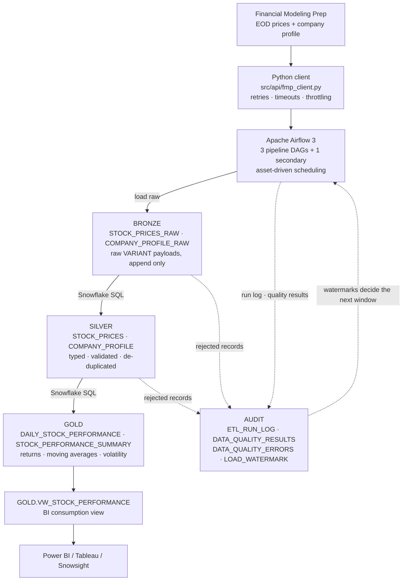
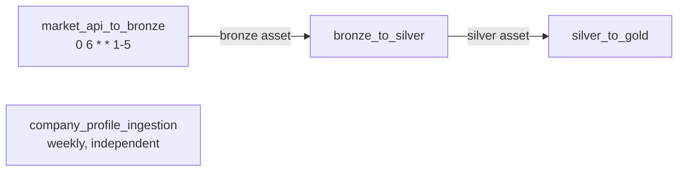

# MarketFlow - End-to-End Financial Data Engineering Pipeline

MarketFlow ingests daily stock market data from the [Financial Modeling Prep](https://site.financialmodelingprep.com/developer/docs) REST API, lands it unchanged in Snowflake, cleans and validates it, and builds analytical datasets for BI - orchestrated by Apache Airflow and runnable locally with Docker.

It is a portfolio project built at portfolio scale: a handful of symbols and a couple of years of daily history. The engineering patterns (medallion layers, watermark-driven incremental loads, quarantine instead of deletion, idempotent MERGEs, auditable runs) are the ones used on much larger pipelines; the infrastructure deliberately is not.

> **Full walkthrough:** [`docs/DATA_FLOW.md`](docs/DATA_FLOW.md) explains every stage (API, Python client, Airflow tasks, Bronze, Silver, data quality, Gold, audit, BI), with the actual SQL logic, task graphs, incremental and failure behaviour, verification queries and troubleshooting.

---

## Table of contents

- [Architecture](#architecture)
- [Technology stack](#technology-stack)
- [Data flow](#data-flow)
- [Snowflake architecture](#snowflake-architecture)
- [The DAGs](#the-dags)
- [Incremental loading](#incremental-loading)
- [Idempotency](#idempotency)
- [Data quality and quarantine](#data-quality-and-quarantine)
- [Auditability and lineage](#auditability-and-lineage)
- [Project layout](#project-layout)
- [Local setup](#local-setup)
- [Verifying a run in Snowflake](#verifying-a-run-in-snowflake)
- [Consuming Gold from a BI tool](#consuming-gold-from-a-bi-tool)
- [Tests](#tests)
- [Troubleshooting](#troubleshooting)
- [Design decisions](#design-decisions)
- [Future enhancements](#future-enhancements)

---

## Architecture



Airflow orchestrates. Snowflake transforms. Python talks to the API and decides *which* window to process - it never pulls a dataset into memory to reshape it.

---

## Technology stack

| Area | Choice |
| --- | --- |
| Orchestration | Apache Airflow 3.4 (LocalExecutor) |
| Warehouse | Snowflake (one database, four schemas) |
| Language | Python 3.13 (as shipped in the Airflow image) |
| Transformations | Snowflake SQL - MERGE, window functions, VARIANT parsing |
| API access | `requests` with urllib3 retry/backoff |
| Runtime | Docker / Docker Compose |
| Testing | pytest |
| Config | YAML for business config, environment variables for secrets |

No Spark, Kafka, Kubernetes or cloud infrastructure: none of them would earn their keep at this data volume.

---

## Data flow

| Layer | Contents | Written by |
| --- | --- | --- |
| **Bronze** | The API response exactly as received, as a `VARIANT`, plus `SYMBOL`, `SOURCE_SYSTEM`, `API_ENDPOINT`, `BATCH_ID`, `RUN_ID`, `INGESTED_AT`. Append only - never updated or deleted. | `market_api_to_bronze` |
| **Silver** | One row per `SYMBOL` + `TRADE_DATE`, typed (`DATE`, `NUMBER`, `TIMESTAMP_NTZ`), validated and de-duplicated. | `bronze_to_silver` |
| **Gold** | Daily returns, 7/30-day moving averages, 30-day volatility, and trailing 7D/30D/90D summaries per symbol. | `silver_to_gold` |
| **Audit** | Run log, data quality results, quarantined records, load watermarks. | every DAG |

Because Bronze is never modified, Silver and Gold can be rebuilt from raw data at any time by resetting their watermarks.

---

## Snowflake architecture

```
FINANCIAL_MARKET_DB
├── BRONZE
│   ├── STOCK_PRICES_RAW          raw EOD price payloads (VARIANT)
│   └── COMPANY_PROFILE_RAW       raw company metadata (VARIANT)
├── SILVER
│   ├── STOCK_PRICES              clean daily prices, PK (SYMBOL, TRADE_DATE)
│   ├── COMPANY_PROFILE           current metadata, PK (SYMBOL)
│   ├── VW_STOCK_PRICES_STAGING   Bronze parsed + validation flags  ← the single source of validation rules
│   └── VW_COMPANY_PROFILE_STAGING
├── GOLD
│   ├── DAILY_STOCK_PERFORMANCE   PK (SYMBOL, TRADE_DATE)
│   ├── STOCK_PERFORMANCE_SUMMARY PK (SYMBOL, PERIOD)
│   └── VW_STOCK_PERFORMANCE      BI-facing view
└── AUDIT
    ├── ETL_RUN_LOG               one row per executed step
    ├── DATA_QUALITY_RESULTS      one row per check per run
    ├── DATA_QUALITY_ERRORS       quarantined records with their payload
    └── LOAD_WATERMARK            control table driving incremental loads
```

`SILVER.VW_STOCK_PRICES_STAGING` is worth a closer look: it parses the Bronze `VARIANT` into typed columns and attaches validation flags plus an `ERRORS` array. The quarantine statement, the data quality summary and the Silver `MERGE` all read that one view, so they can never disagree about what "valid" means.

### Required privileges

The setup scripts need a role that can create a database (`SYSADMIN` works on a standard trial account), and the pipeline role needs:

| Object | Privilege |
| --- | --- |
| `FINANCIAL_MARKET_DB` | `USAGE` |
| All four schemas | `USAGE` |
| Bronze/Silver/Gold/Audit tables | `SELECT`, `INSERT`, `UPDATE`, `DELETE` |
| Silver/Gold views | `SELECT` |
| Warehouse (e.g. `COMPUTE_WH`) | `USAGE`, `OPERATE` |

If your role cannot create databases, ask an administrator to create `FINANCIAL_MARKET_DB` and grant ownership, then start from `sql/02_create_schemas.sql`.

---

## The DAGs

Downstream DAGs are scheduled on **Airflow assets**, not on staggered clock times: Silver runs when Bronze has actually been updated, Gold when Silver has.



### 1. `market_api_to_bronze`

`prepare_run → build_fetch_plan → ingest_symbol (one mapped task per symbol) → record_run_audit`

Builds a per-symbol fetch plan from the watermarks, calls the API, quarantines structurally unusable records and appends the rest to Bronze. Dynamic task mapping gives each symbol its own task instance: if one symbol fails, the others are still fetched, stored and watermarked. `record_run_audit` (and with it the Bronze asset event) only runs when every symbol succeeded, so Silver picks up the stored rows on the next successful run. `max_active_tis_per_dag=2` keeps the request rate friendly.

### 2. `bronze_to_silver`

`prepare_run → plan_window (short-circuits when nothing is new) → transform_to_silver → check_data_quality → advance_watermark`

`transform_to_silver` runs four statements in **one Snowflake transaction**: quarantine invalid records, quarantine superseded duplicates, `MERGE` the valid records, write the quality results. Either all of it lands or none of it does. The watermark is advanced by a separate task afterwards, so a crash in between simply means the same window is reprocessed - which the `MERGE` handles.

### 3. `silver_to_gold`

`prepare_run → check_silver_availability → calculate_daily_performance → calculate_summary_metrics → record_run_audit`

Only symbols touched by the Silver window are recalculated, from their earliest changed trade date onwards, with 60 extra days of history read so the 30-day windows are complete at the first recalculated row.

### 4. `company_profile_ingestion` (secondary)

Weekly reference-data pipeline: API → `BRONZE.COMPANY_PROFILE_RAW` → `SILVER.COMPANY_PROFILE`. Completely independent of the price pipeline - if the profile endpoint is not available on your FMP plan, this DAG fails alone and prices keep flowing.

---

## Incremental loading

`AUDIT.LOAD_WATERMARK` is the control table. **A watermark is only written after the step that produced the data has succeeded**, so a failed or partial run never advances the pipeline. Nothing relies on `MAX(date)` in a target table, which could reflect a half-finished load.

| Layer | Watermark | Next window |
| --- | --- | --- |
| Bronze | `LAST_LOADED_DATE` per symbol | `last_loaded_date - 3 days → today` |
| Silver | `LAST_PROCESSED_TS` (Bronze `INGESTED_AT`) | `(watermark, MAX(INGESTED_AT)]` |
| Gold | `LAST_PROCESSED_TS` (Silver `LOADED_AT`) | `(watermark, MAX(LOADED_AT)]` |

**First run:** no watermark exists, so Bronze requests `initial_lookback_days` (730 by default) of history, and Silver/Gold process everything from a `1900-01-01` sentinel.

**Later runs:** Bronze re-requests the last few days (`incremental_overlap_days`) so late vendor corrections are picked up; the Silver `MERGE` makes the overlap harmless. Silver and Gold pin their upper bound once at planning time, so every statement in a run sees exactly the same set of rows even if a new load lands mid-run.

**After a failure:** the watermark did not move, so the next run reprocesses the same window. No manual cleanup.

---

## Idempotency

| Layer | Strategy | Rerunning the same data |
| --- | --- | --- |
| Bronze | Append only | Adds raw rows (deliberate: ingestion history is kept) |
| Silver | `MERGE` on `(SYMBOL, TRADE_DATE)` | Updates in place, never duplicates |
| Gold | `MERGE` on `(SYMBOL, TRADE_DATE)` and `(SYMBOL, PERIOD)` | Recalculated in place |
| Audit | Quality rows deleted per `RUN_ID` before being rewritten | Retry produces one set of rows, not two |

The Silver `MERGE` additionally guards with `WHEN MATCHED AND s.INGESTED_AT >= t.INGESTED_AT`, so replaying older raw data can never overwrite a newer record.

---

## Data quality and quarantine

Rejected records are **never deleted**. They land in `AUDIT.DATA_QUALITY_ERRORS` with the original payload attached, so they can be inspected - or replayed - later.

Validation happens at two levels, deliberately:

| Where | Checks | Error type |
| --- | --- | --- |
| Python, before Bronze | payload is an object, date parses, close is numeric | `INVALID_API_RECORD` |
| Snowflake, Bronze → Silver | required fields present | `NULL_REQUIRED_FIELD` |
| | date parseable, not in the future, not before 1990 | `INVALID_DATE` |
| | `HIGH >= LOW/OPEN/CLOSE`, `LOW <= OPEN/CLOSE`, `CLOSE > 0` | `INVALID_PRICE` |
| | `VOLUME >= 0` and present | `INVALID_VOLUME` |
| | superseded row for the same `SYMBOL` + `TRADE_DATE` | `DUPLICATE_RECORD` |

A record can fail several checks and is then quarantined once per error type. Every check also writes a row to `AUDIT.DATA_QUALITY_RESULTS`:

```
CHECK_NAME           STATUS  RECORDS_CHECKED  RECORDS_FAILED
NULL_REQUIRED_FIELD  PASS    3500             0
DATE_VALIDATION      PASS    3500             0
PRICE_RANGE          PASS    3500             0
VOLUME_RANGE         PASS    3500             0
DUPLICATES           PASS    3500             0
```

Failing checks are logged as warnings and persisted, but do not fail the task: bad vendor rows are expected, and quarantining them is the designed behaviour, not an incident.

---

## Auditability and lineage

Every step writes to `AUDIT.ETL_RUN_LOG` (`RUN_ID`, `DAG_ID`, `TASK_ID`, `BATCH_ID`, `LAYER`, timings, status, source/target/rejected counts, error message). An `on_failure_callback`, set on every task through `default_args`, records failures even when the task died before it could open its own audit row.

Every DAG run generates its own `BATCH_ID`. The ingestion run's `BATCH_ID` travels with the data from Bronze into Silver; Gold rows carry the Gold run's ids:

```
FMP API record
   ↓                         BRONZE.STOCK_PRICES_RAW.RAW_DATA   (BATCH_ID, RUN_ID, INGESTED_AT)
Bronze raw payload
   ↓                         SILVER.STOCK_PRICES                (same BATCH_ID, INGESTED_AT, LOADED_AT)
Silver typed record
   ↓                         GOLD.DAILY_STOCK_PERFORMANCE       (BATCH_ID, RUN_ID of the Gold run)
Gold analytical record
```

So from any Gold row you can find the Silver row, the raw Bronze payload it came from, the run that loaded it, and every quality check that run performed.

---

## Project layout

```
marketflow-data-engineering/
├── dags/
│   ├── market_api_to_bronze.py        DAG 1 - API → Bronze
│   ├── bronze_to_silver.py            DAG 2 - Bronze → Silver
│   ├── silver_to_gold.py              DAG 3 - Silver → Gold
│   └── company_profile_ingestion.py   secondary reference-data DAG
├── src/
│   ├── api/fmp_client.py              REST client (retries, timeouts, throttling)
│   ├── warehouse/                     connection, statement execution, audit helpers
│   ├── transformations/               which window to process, in what order
│   ├── validation/data_quality.py     API-response validation
│   ├── orchestration/common.py        assets, default args, failure callback
│   └── utils/                         config loading, logging helpers
├── sql/
│   ├── 01..07_*.sql                   database, schemas, tables, views (run once)
│   └── transformations/               one parameterised statement per file
│       ├── bronze/  silver/  gold/  audit/
├── config/
│   ├── pipeline.yaml                  API, load and warehouse settings
│   └── symbols.yaml                   the symbol list
├── docs/DATA_FLOW.md                  end-to-end data flow documentation
├── tests/                             pytest suite (no credentials required)
├── scripts/setup_snowflake.py         optional: run sql/01..07 for you
├── docker/Dockerfile                  Airflow image + Snowflake provider
├── docker-compose.yml                 Postgres + API server + scheduler + DAG processor + triggerer
├── requirements.txt / requirements-dev.txt
├── .env.example
└── README.md
```

Two naming notes: the Snowflake helpers live in `src/warehouse/` rather than `src/snowflake/` so that `import snowflake.connector` can never resolve to project code, and Gold uses `MOVING_AVG_7D` / `MOVING_AVG_30D` / `VOLATILITY_30D` because Snowflake identifiers cannot start with a digit unless quoted.

---

## Local setup

### What you need

1. A free **FMP API key**: <https://site.financialmodelingprep.com/developer/docs>
2. A **Snowflake account** (a trial works) with a role that can create a database, plus a running warehouse.
3. **Docker Desktop**. On Windows it needs WSL2 (`wsl --install` in an elevated PowerShell, then reboot).

Then: fill in `.env`, run the SQL setup scripts, start Docker and trigger the first DAG.

Everything else - tables, views, DAGs, transformations, tests - is already in this repository.

### 1. Clone and configure

```bash
git clone <your-repo-url> marketflow-data-engineering
cd marketflow-data-engineering
cp .env.example .env          # Windows: copy .env.example .env
```

Fill in `.env`:

```dotenv
FMP_API_KEY=your_fmp_key
SNOWFLAKE_ACCOUNT=abcd-xy12345      # account identifier, not the full URL
SNOWFLAKE_USER=your_user
SNOWFLAKE_PASSWORD=your_password
SNOWFLAKE_ROLE=SYSADMIN
SNOWFLAKE_WAREHOUSE=COMPUTE_WH
SNOWFLAKE_DATABASE=FINANCIAL_MARKET_DB
SNOWFLAKE_SCHEMA=BRONZE
```

Optional but recommended before sharing the environment with anyone:

```bash
# generate a Fernet key for FERNET_KEY in .env
python -c "from cryptography.fernet import Fernet; print(Fernet.generate_key().decode())"
```

`.env` is in `.gitignore` and must never be committed.

### 2. Create the Snowflake objects

Run these in a Snowsight worksheet, **in order**:

| # | Script | Creates |
| --- | --- | --- |
| 1 | `sql/01_create_database.sql` | `FINANCIAL_MARKET_DB` |
| 2 | `sql/02_create_schemas.sql` | `BRONZE`, `SILVER`, `GOLD`, `AUDIT` |
| 3 | `sql/03_create_bronze_tables.sql` | raw tables |
| 4 | `sql/04_create_silver_tables.sql` | clean tables |
| 5 | `sql/05_create_gold_tables.sql` | analytical tables |
| 6 | `sql/06_create_audit_tables.sql` | run log, quality tables, watermark |
| 7 | `sql/07_create_views.sql` | staging views + `GOLD.VW_STOCK_PERFORMANCE` |

All of them are re-runnable. Alternatively, after step 3 below:

```bash
docker compose run --rm airflow-cli python /opt/airflow/project/scripts/setup_snowflake.py
```

### 3. Start Airflow

```bash
docker compose build
docker compose up -d
docker compose ps          # all services should become healthy
```

Open <http://localhost:8080> and log in with `_AIRFLOW_WWW_USER_USERNAME` / `_AIRFLOW_WWW_USER_PASSWORD` from `.env` (`airflow` / `airflow` by default).

The Snowflake connection `snowflake_default` is built from `.env` by docker-compose - there is nothing to configure in the UI.

### 4. Run the pipeline

All DAGs start **paused** (`AIRFLOW__CORE__DAGS_ARE_PAUSED_AT_CREATION`), including the downstream ones.

1. Unpause **`bronze_to_silver`** and **`silver_to_gold`** first, so they are ready for asset events.
2. Unpause **`company_profile_ingestion`** and trigger it once to populate company metadata for the BI view.
3. Unpause **`market_api_to_bronze`** and trigger it. The first run loads two years of history for all seven symbols (about 3,500 records; a few minutes).
4. When it finishes, `bronze_to_silver` starts by itself (scheduled on the Bronze asset), then `silver_to_gold` the same way.

Unpausing a cron DAG also runs its most recent missed schedule (`catchup=False` limits this to one run), so a manual trigger right after unpausing produces two runs. The second only loads the incremental overlap, which is harmless.

The same from the command line:

```bash
for d in bronze_to_silver silver_to_gold company_profile_ingestion market_api_to_bronze; do
  docker compose exec airflow-scheduler airflow dags unpause "$d"
done
docker compose exec airflow-scheduler airflow dags trigger company_profile_ingestion
docker compose exec airflow-scheduler airflow dags trigger market_api_to_bronze
```

Useful commands:

```bash
docker compose logs -f airflow-scheduler
docker compose run --rm airflow-cli airflow dags list
docker compose down            # stop
docker compose down -v         # stop and delete the Airflow metadata database
```

---

## Verifying a run in Snowflake

```sql
USE DATABASE FINANCIAL_MARKET_DB;

-- Bronze: raw payloads landed
SELECT SYMBOL, COUNT(*) AS RECORDS, MAX(INGESTED_AT) AS LAST_INGESTED
FROM BRONZE.STOCK_PRICES_RAW
GROUP BY SYMBOL ORDER BY SYMBOL;

-- Silver: one row per symbol and trading day
SELECT SYMBOL, COUNT(*) AS TRADING_DAYS, MIN(TRADE_DATE) AS FROM_DATE, MAX(TRADE_DATE) AS TO_DATE
FROM SILVER.STOCK_PRICES
GROUP BY SYMBOL ORDER BY SYMBOL;

-- Silver really is unique on the business key (expect zero rows)
SELECT SYMBOL, TRADE_DATE, COUNT(*)
FROM SILVER.STOCK_PRICES
GROUP BY SYMBOL, TRADE_DATE HAVING COUNT(*) > 1;

-- Gold: the most recent calculated rows
SELECT SYMBOL, TRADE_DATE, CLOSE_PRICE, DAILY_RETURN_PERCENT, MOVING_AVG_7D, MOVING_AVG_30D, VOLATILITY_30D
FROM GOLD.DAILY_STOCK_PERFORMANCE
QUALIFY ROW_NUMBER() OVER (PARTITION BY SYMBOL ORDER BY TRADE_DATE DESC) = 1
ORDER BY SYMBOL;

SELECT * FROM GOLD.STOCK_PERFORMANCE_SUMMARY ORDER BY SYMBOL, PERIOD;

-- Audit: what ran, what it processed, what it rejected
SELECT RUN_ID, DAG_ID, TASK_ID, STATUS, SOURCE_RECORD_COUNT, TARGET_RECORD_COUNT, REJECTED_RECORD_COUNT, DURATION_SECONDS
FROM AUDIT.ETL_RUN_LOG ORDER BY START_TIME DESC LIMIT 50;

SELECT * FROM AUDIT.DATA_QUALITY_RESULTS ORDER BY CHECKED_AT DESC LIMIT 25;
SELECT ERROR_TYPE, COUNT(*) FROM AUDIT.DATA_QUALITY_ERRORS GROUP BY ERROR_TYPE;
SELECT * FROM AUDIT.LOAD_WATERMARK ORDER BY LAYER, TABLE_NAME, SYMBOL;

-- Lineage: from a Gold row back to the raw payload
SELECT g.SYMBOL, g.TRADE_DATE, g.CLOSE_PRICE, s.BATCH_ID, b.RAW_DATA
FROM GOLD.DAILY_STOCK_PERFORMANCE g
JOIN SILVER.STOCK_PRICES s ON s.SYMBOL = g.SYMBOL AND s.TRADE_DATE = g.TRADE_DATE
JOIN BRONZE.STOCK_PRICES_RAW b ON b.BATCH_ID = s.BATCH_ID AND b.SYMBOL = s.SYMBOL
                              AND b.RAW_DATA:date::DATE = s.TRADE_DATE
WHERE g.SYMBOL = 'AAPL'
ORDER BY g.TRADE_DATE DESC LIMIT 5;
```

---

## Consuming Gold from a BI tool

`GOLD.VW_STOCK_PERFORMANCE` joins daily performance with company metadata and the trailing 30-day summary - one wide, flat, BI-friendly table.

In Power BI: *Get data → Snowflake*, server `<account>.snowflakecomputing.com`, warehouse `COMPUTE_WH`, then pick `FINANCIAL_MARKET_DB → GOLD → VW_STOCK_PERFORMANCE`. In Tableau: the Snowflake connector, same objects. Import mode is plenty at this volume.

No BI tool is required to run the pipeline, and none is included in this repository.

---

## Tests

```bash
# unit tests - no Snowflake, no API key, no virtualenv required for the pipeline itself
pip install -r requirements-dev.txt
pytest

# inside the running container (also runs the Airflow DAG-import tests)
docker compose exec -w /opt/airflow/project airflow-scheduler python -m pytest -q
```

The suite covers API response parsing (both the `/stable` and legacy payload shapes), authentication/rate-limit/transport error handling, that the API key never reaches a log or an exception message, required-field/null/price/volume/date validation, duplicate detection, configuration loading and overrides, the initial-vs-incremental fetch plan, Bronze batching and parameter binding, processing-window selection, the daily-return formula, and a contract check over every SQL file (bind parameters only, no credentials, expected window functions and MERGE keys, no renamed files).

DAG-import tests need Airflow and are skipped automatically outside the container.

---

## Troubleshooting

| Symptom | Cause and fix |
| --- | --- |
| Docker Desktop runs but every `docker` command returns HTTP 500 (Windows) | WSL2 is not installed: `wsl --install` in an elevated PowerShell, then reboot. |
| `docker compose up` fails with "env file .env not found" | You skipped `cp .env.example .env`. |
| Scheduler / DAG processor / triggerer show `(unhealthy)` but work | `airflow jobs check` is slow to start under WSL2; the health-check timeout is 30 s in `docker-compose.yml`, raise it if needed. |
| DAG import error: `URI format snowflake:// must contain ...` | `SNOWFLAKE_ACCOUNT` is empty; asset URIs include the account (`snowflake://<account>/<db>/<schema>/<table>`). |
| Bronze has more rows than Silver | Expected: the 3-day overlap re-fetch is appended to Bronze and merged into existing Silver rows. |
| Services restart in a loop; logs mention memory | Docker Desktop needs ~4 GB RAM (Settings → Resources). |
| `FMP_API_KEY is not set` | `FMP_API_KEY` is empty in `.env`; recreate the containers after editing it (`docker compose up -d --force-recreate`). |
| `authentication failed ... check FMP_API_KEY` | The key is wrong, or the endpoint is not in your FMP plan. The free plan covers the EOD price endpoint used here. |
| `250001 Could not connect to Snowflake backend` | `SNOWFLAKE_ACCOUNT` should be the account identifier (`abcd-xy12345`), not the full URL. |
| `Object 'BRONZE.STOCK_PRICES_RAW' does not exist` | The SQL setup scripts have not been run, or the role lacks `USAGE` on the database/schema. |
| `bronze_to_silver` never starts | It is asset-triggered and starts paused: unpause it, and make sure `market_api_to_bronze` finished successfully (its `record_run_audit` task emits the asset event). |
| A DAG run is skipped immediately | The short-circuit task found no new data - the expected result when nothing has changed. |
| Moving averages are `NULL` for early dates | By design: a 7/30-day average is only published once 7/30 observations exist. |
| Rejected records appear in `DATA_QUALITY_ERRORS` | Also by design - inspect `ERROR_TYPE` and `RAW_RECORD` there. |
| Port 8080 already in use | Change the published port in `docker-compose.yml` (`"8081:8080"`). |

To reprocess a layer from scratch, delete its watermark row and rerun - Bronze is still intact:

```sql
DELETE FROM AUDIT.LOAD_WATERMARK WHERE LAYER = 'SILVER';
```

---

## Design decisions

**SQL for transformations, Python for orchestration.** Python fetches, validates structurally and decides the window; every cleaning, de-duplication and analytical calculation is Snowflake SQL in a file under `sql/`. No dataset is ever pulled into Pandas - the warehouse does the work.

**Validation rules live in a view.** `SILVER.VW_STOCK_PRICES_STAGING` holds the typing and the checks, and the quarantine, summary and MERGE statements all read it. One definition, three consumers.

**Asset scheduling over staggered cron.** Silver and Gold run when upstream data exists, not at 10:15 and 10:30 in the hope that the previous DAG finished.

**One transaction for the Silver step.** Quarantine, merge and quality results are written together or not at all. The spec's separate "run DQ / load / quarantine" tasks would each need their own transaction and could leave Silver updated with no audit trail; the checks are still visible as separate rows in `AUDIT.DATA_QUALITY_RESULTS`, and `check_data_quality` is a separate task that reads them back.

**Moving averages and volatility in one MERGE.** They share a window definition and a single pass over the same rows; three statements would rewrite the Gold table three times for the same result.

**Watermarks in a control table, not `MAX(date)`.** A target table's maximum date can come from a half-finished load; a watermark is only written after a step succeeds.

**Assumptions made.** The FMP `/stable` EOD endpoint returns the fields listed in `config/pipeline.yaml` (the client also accepts the legacy `/api/v3` response shape); "today" is UTC; 7/30/90-day summary windows are calendar days over available trading days; volatility is the sample standard deviation of daily percentage returns, not annualised; the account's Snowflake user can create the objects in `sql/01..07`.

---

## Future enhancements

Not implemented here - candidates for a V2:

- dbt for transformation management and lineage docs
- A Power BI or Streamlit dashboard on `GOLD.VW_STOCK_PERFORMANCE`
- Additional providers behind the same client interface
- Fundamentals, technical indicators and portfolio analytics
- Alerting on failed runs and failed quality checks
- CI/CD (lint, tests and DAG-import checks on every push)
- Cloud deployment of Airflow and secrets management

---

## License

MIT - see `LICENSE` if you add one before publishing.
