# MarketFlow — How the Data Flows

This document explains, end to end, how MarketFlow actually works: which code runs, in which Airflow task, against which Snowflake object, and what happens to the data at every step. Everything here is taken from the implementation in this repository: the DAGs in `dags/`, the Python in `src/`, the SQL in `sql/` and the Docker setup in `docker-compose.yml` and `docker/Dockerfile`.

Numbers quoted as "from a real run" come from the first two runs of the pipeline on 7 symbols (one initial load, then one incremental load).

---

## Contents

1. [Project Overview](#1-project-overview)
2. [End-to-End Architecture](#2-end-to-end-architecture)
3. [Source API](#3-source-api)
4. [Python API Layer](#4-python-api-layer)
5. [Airflow Architecture](#5-airflow-architecture)
6. [Bronze Layer](#6-bronze-layer)
7. [Silver Layer](#7-silver-layer)
8. [Data Quality](#8-data-quality)
9. [Gold Layer](#9-gold-layer)
10. [Incremental Processing](#10-incremental-processing)
11. [Audit and Observability](#11-audit-and-observability)
12. [Idempotency](#12-idempotency)
13. [Error Handling](#13-error-handling)
14. [Snowflake Data Model](#14-snowflake-data-model)
15. [Docker Architecture](#15-docker-architecture)
16. [Configuration and Secrets](#16-configuration-and-secrets)
17. [How to Run the Project](#17-how-to-run-the-project)
18. [How to Verify the Pipeline](#18-how-to-verify-the-pipeline)
19. [How I Would Explain This Project in an Interview](#19-how-i-would-explain-this-project-in-an-interview)
20. [Troubleshooting](#20-troubleshooting)

---

## 1. Project Overview

MarketFlow is a batch data pipeline for daily stock market data.

- **Source:** the Financial Modeling Prep (FMP) REST API, end-of-day prices and company profiles.
- **Symbols:** AAPL, MSFT, GOOGL, AMZN, NVDA, META, TSLA (configured in `config/symbols.yaml`).
- **Orchestration:** Apache Airflow 3.4, LocalExecutor, running in Docker.
- **Warehouse:** Snowflake, one database (`FINANCIAL_MARKET_DB`) with four schemas: `BRONZE`, `SILVER`, `GOLD`, `AUDIT`.
- **Transformations:** Snowflake SQL (`MERGE`, window functions, `VARIANT` parsing). Python never loads a dataset into memory to reshape it.

The design follows the medallion pattern:

| Layer | What it holds |
| --- | --- |
| Bronze | The API response exactly as received, append-only. |
| Silver | Typed, validated, de-duplicated prices: one row per symbol per trading day. |
| Gold | Analytics: daily returns, moving averages, volatility and trailing summaries. |
| Audit | Run log, data quality results, quarantined records and load watermarks. |

It is a portfolio-scale project. A full initial load is about 3,500 price rows (7 symbols × about 500 trading days). The patterns are the ones used in larger pipelines (watermark-driven incremental loads, quarantine instead of deletion, idempotent `MERGE`s, an audit trail per task), but the infrastructure is deliberately small.

---

## 2. End-to-End Architecture

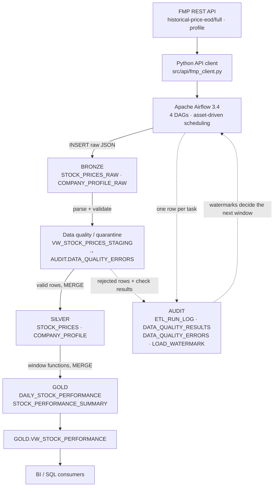

**Who does what:**

- **Python** calls the API, does a structural check on each record, decides *which window* of data to process, and runs SQL files with bound parameters.
- **Snowflake SQL** does all the parsing, validation, de-duplication and analytics.
- **Airflow** decides *when* things run, retries failures and passes small metadata between tasks (run ids, windows, counts). It never passes datasets.

### One complete run, as a sequence

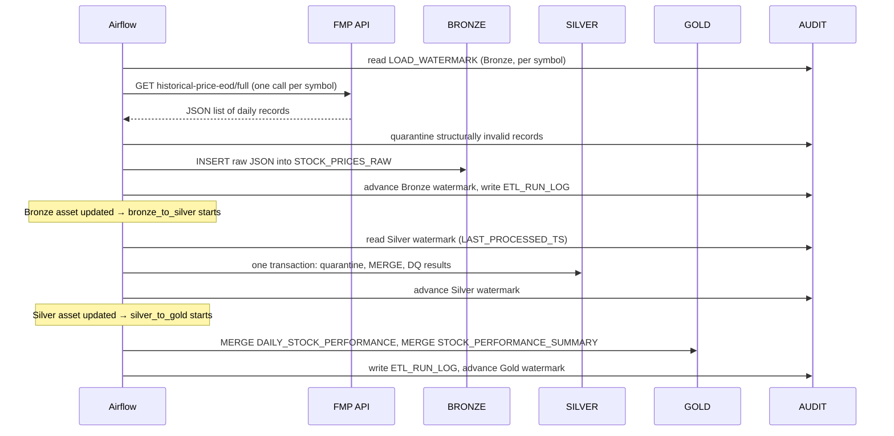

### Stage reference cards

Each card answers the same ten questions for one stage. The detailed sections that follow explain each card further.

#### Stage A: FMP API

| | |
| --- | --- |
| **What happens** | FMP serves end-of-day prices and company profiles over HTTPS. |
| **File/module** | Called from `src/api/fmp_client.py`; endpoints configured in `config/pipeline.yaml`. |
| **DAG/task** | `market_api_to_bronze.ingest_symbol`, `company_profile_ingestion.ingest_profiles` |
| **Snowflake objects** | None directly. |
| **Data in** | `symbol`, `from`, `to`, `apikey` query parameters. |
| **Data out** | JSON list of daily price records; JSON list holding one profile object. |
| **Transformations** | None. |
| **Error handling** | HTTP status codes and error bodies are interpreted by the client (Stage B). |
| **Data quality** | None at source. |
| **Incremental behaviour** | The `from` date comes from the Bronze watermark. |

#### Stage B: Python API client

| | |
| --- | --- |
| **What happens** | Builds the request, retries transient failures, throttles, normalises the response into a flat list of dicts. |
| **File/module** | `src/api/fmp_client.py` (`FMPClient`, `normalise_price_payload`) |
| **DAG/task** | `ingest_symbol` (prices), `ingest_profiles` (profiles) |
| **Snowflake objects** | None. |
| **Data in** | Symbol and a date range from the fetch plan. |
| **Data out** | `list[dict]`, each dict with `symbol` guaranteed set. |
| **Transformations** | Accepts both the `/stable` list shape and the legacy `{"historical": [...]}` shape; upper-cases the symbol. |
| **Error handling** | urllib3 retry with backoff on 429/5xx; typed exceptions `FMPAuthenticationError`, `FMPRateLimitError`, `FMPResponseError`; the API key is redacted from every message. |
| **Data quality** | Fails the whole response (`FMPResponseError`) if it isn't JSON or contains a record that isn't an object. |
| **Incremental behaviour** | None of its own; it requests whatever range it is given. |

#### Stage C: Airflow orchestration

| | |
| --- | --- |
| **What happens** | Four DAGs; Silver and Gold are triggered by Airflow assets instead of clock times. |
| **File/module** | `dags/*.py`, shared pieces in `src/orchestration/common.py` |
| **DAG/task** | `market_api_to_bronze`, `bronze_to_silver`, `silver_to_gold`, `company_profile_ingestion` |
| **Snowflake objects** | Connects through the `snowflake_default` connection. |
| **Data in** | Schedules (cron for ingestion) and asset events. |
| **Data out** | Small XCom payloads: `run_id`, `batch_id`, processing window, counts. |
| **Transformations** | None. Airflow only orchestrates. |
| **Error handling** | 3 retries per task, exponential backoff starting at 2 minutes (max 15); `on_failure_callback` writes `FAILED` to `AUDIT.ETL_RUN_LOG`. |
| **Data quality** | `bronze_to_silver.check_data_quality` reads results back and logs them. |
| **Incremental behaviour** | `@task.short_circuit` skips the rest of a run when there is no new data. |

#### Stage D: Bronze

| | |
| --- | --- |
| **What happens** | Raw records are appended as `VARIANT` with lineage columns. |
| **File/module** | `src/transformations/api_to_bronze.py`, `src/warehouse/loader.py`, `sql/transformations/bronze/*.sql` |
| **DAG/task** | `market_api_to_bronze.ingest_symbol`, `company_profile_ingestion.ingest_profiles` |
| **Snowflake objects** | `BRONZE.STOCK_PRICES_RAW`, `BRONZE.COMPANY_PROFILE_RAW` |
| **Data in** | Structurally valid API records. |
| **Data out** | One row per API record: `RAW_DATA`, `SYMBOL`, `SOURCE_SYSTEM`, `API_ENDPOINT`, `BATCH_ID`, `RUN_ID`, `INGESTED_AT`. |
| **Transformations** | None to the payload: `PARSE_JSON` only turns text into `VARIANT`. |
| **Error handling** | Structurally invalid records go to `AUDIT.DATA_QUALITY_ERRORS` as `INVALID_API_RECORD`. |
| **Data quality** | Python structural checks: object, `date` present and ISO, `close` present and numeric. |
| **Incremental behaviour** | Per-symbol `LAST_LOADED_DATE` watermark; overlap of 3 days on every incremental run. |

#### Stage E: Silver

| | |
| --- | --- |
| **What happens** | Bronze JSON is parsed, typed, validated, de-duplicated and `MERGE`d. |
| **File/module** | `src/transformations/bronze_to_silver.py`, `sql/07_create_views.sql`, `sql/transformations/silver/*.sql` |
| **DAG/task** | `bronze_to_silver.transform_to_silver`; `company_profile_ingestion.merge_profiles_to_silver` |
| **Snowflake objects** | `SILVER.VW_STOCK_PRICES_STAGING`, `SILVER.STOCK_PRICES`, `SILVER.VW_COMPANY_PROFILE_STAGING`, `SILVER.COMPANY_PROFILE` |
| **Data in** | Bronze rows with `INGESTED_AT` inside the window. |
| **Data out** | One row per `(SYMBOL, TRADE_DATE)` with typed columns. |
| **Transformations** | `TRY_TO_DATE`, `TRY_TO_DECIMAL`, `TRY_TO_NUMBER`, `UPPER`, `ROW_NUMBER` de-duplication, `MERGE`. |
| **Error handling** | All statements run in one Snowflake transaction; on error everything rolls back. |
| **Data quality** | Null, date, price and volume checks plus duplicates (Stage F). |
| **Incremental behaviour** | `INGESTED_AT` window between the Silver watermark and `MAX(INGESTED_AT)`. |

#### Stage F: Data quality and quarantine

| | |
| --- | --- |
| **What happens** | Every row is flagged in a view; invalid rows and superseded duplicates are copied to quarantine; one result row per check is written. |
| **File/module** | `src/validation/data_quality.py` (Python level), `SILVER.VW_STOCK_PRICES_STAGING`, `sql/transformations/silver/11`, `12`, `14` |
| **DAG/task** | `market_api_to_bronze.ingest_symbol`, `bronze_to_silver.transform_to_silver`, `bronze_to_silver.check_data_quality` |
| **Snowflake objects** | `AUDIT.DATA_QUALITY_ERRORS`, `AUDIT.DATA_QUALITY_RESULTS` |
| **Data in** | API records (Python) and the Silver window (SQL). |
| **Data out** | Quarantine rows with the original payload; PASS/FAIL per check. |
| **Transformations** | `LATERAL FLATTEN` over the `ERRORS` array → one quarantine row per error. |
| **Error handling** | Failing checks are logged as warnings and do not fail the task. |
| **Data quality** | `INVALID_API_RECORD`, `NULL_REQUIRED_FIELD`, `INVALID_DATE`, `INVALID_PRICE`, `INVALID_VOLUME`, `DUPLICATE_RECORD`. |
| **Incremental behaviour** | Runs over the same window as the Silver load. |

#### Stage G: Gold

| | |
| --- | --- |
| **What happens** | Daily metrics and trailing-period summaries are computed with window functions. |
| **File/module** | `src/transformations/silver_to_gold.py`, `sql/transformations/gold/*.sql` |
| **DAG/task** | `silver_to_gold.calculate_daily_performance`, `calculate_summary_metrics` |
| **Snowflake objects** | `GOLD.DAILY_STOCK_PERFORMANCE`, `GOLD.STOCK_PERFORMANCE_SUMMARY` |
| **Data in** | Silver rows with `LOADED_AT` in the window, plus 60 days of earlier history. |
| **Data out** | Returns, 7/30-day moving averages, 30-day volatility; 7D/30D/90D summaries. |
| **Transformations** | `LAG`, `AVG ... ROWS BETWEEN`, `STDDEV_SAMP`, `MIN_BY`/`MAX_BY`, `MERGE`. |
| **Error handling** | Airflow retries; `MERGE` makes a retry safe; watermark only moves at the end. |
| **Data quality** | Moving averages and volatility stay `NULL` until their window is full. |
| **Incremental behaviour** | Only changed symbols, only from their earliest changed date. |

#### Stage H: Audit

| | |
| --- | --- |
| **What happens** | Every task writes its start, end, status and counts; watermarks are stored; quality results and rejects are kept. |
| **File/module** | `src/warehouse/audit.py`, `sql/transformations/audit/*.sql`, `src/orchestration/common.py` |
| **DAG/task** | Every task that touches Snowflake. |
| **Snowflake objects** | `AUDIT.ETL_RUN_LOG`, `AUDIT.DATA_QUALITY_RESULTS`, `AUDIT.DATA_QUALITY_ERRORS`, `AUDIT.LOAD_WATERMARK` |
| **Data in** | Run identity, counts, error messages, windows. |
| **Data out** | A queryable history of every run. |
| **Transformations** | `MERGE` on natural keys so retries update rather than duplicate. |
| **Error handling** | The failure callback never raises, so audit problems cannot hide the original error. |
| **Data quality** | Stores the results. |
| **Incremental behaviour** | `LOAD_WATERMARK` *is* the incremental state of the whole pipeline. |

#### Stage I: BI / consumption

| | |
| --- | --- |
| **What happens** | A view joins Gold metrics with company metadata and the 30-day summary. |
| **File/module** | `sql/07_create_views.sql` |
| **DAG/task** | None. It's a view and is always current. |
| **Snowflake objects** | `GOLD.VW_STOCK_PERFORMANCE` |
| **Data in** | `GOLD.DAILY_STOCK_PERFORMANCE`, `SILVER.COMPANY_PROFILE`, `GOLD.STOCK_PERFORMANCE_SUMMARY` (`PERIOD = '30D'`). |
| **Data out** | One wide row per symbol per trading day. |
| **Transformations** | Two `LEFT JOIN`s. |
| **Error handling** | `LEFT JOIN` means missing profiles give `NULL` company columns, not missing rows. |
| **Data quality** | Inherited from Silver and Gold. |
| **Incremental behaviour** | Not applicable. |

No BI tool is included in the repository. The view can be queried from Snowsight or any tool with a Snowflake connector.

---

## 3. Source API

**Provider:** Financial Modeling Prep, "stable" API.

| Setting (`config/pipeline.yaml`) | Value |
| --- | --- |
| `api.base_url` | `https://financialmodelingprep.com/stable` |
| `api.historical_prices_endpoint` | `historical-price-eod/full` |
| `api.company_profile_endpoint` | `profile` |
| `api.timeout_seconds` | `30` |
| `api.max_retries` | `3` |
| `api.backoff_factor` | `2.0` |
| `api.request_delay_seconds` | `1.0` |

### End-of-day prices

```
GET https://financialmodelingprep.com/stable/historical-price-eod/full
    ?symbol=AAPL&from=2024-11-18&to=2026-11-16&apikey=<FMP_API_KEY>
```

- One request per symbol covers the whole date range (the endpoint isn't paginated).
- The response is a JSON **list**, one object per trading day. The keys observed in Bronze are:

```json
{
  "symbol": "AAPL",
  "date": "2026-11-16",
  "open": 0.0, "high": 0.0, "low": 0.0, "close": 0.0,
  "volume": 0,
  "change": 0.0, "changePercent": 0.0,
  "vwap": 0.0
}
```

### Company profile

```
GET https://financialmodelingprep.com/stable/profile?symbol=AAPL&apikey=<FMP_API_KEY>
```

The response is a JSON list with one object. It has many fields (`companyName`, `sector`, `industry`, `exchange`, `exchangeFullName`, `currency`, `country`, `marketCap`, `description`, `ceo`, …). The whole object is stored in Bronze; Silver extracts only the fields it needs.

### Authentication

FMP uses an API key passed as the `apikey` **query parameter**. The client reads it from the `FMP_API_KEY` environment variable. It is excluded from the request log line, stripped from error messages by `redact()` in `src/utils/logging_utils.py`, and never written to Snowflake (`API_ENDPOINT` stores only the endpoint path, not the full URL).

The client also accepts the legacy `/api/v3` response shape (`{"symbol": ..., "historical": [...]}`), so the base URL can be changed in config without code changes. The pipeline uses `/stable`.

---

## 4. Python API Layer

`src/api/fmp_client.py` defines `FMPClient`, a small HTTP client with two public methods:

| Method | Returns |
| --- | --- |
| `get_historical_prices(symbol, start_date, end_date)` | `list[dict]` of daily records |
| `get_company_profile(symbol)` | `dict` or `None` when the API returns nothing |

The rest of the pipeline depends only on these two methods, so another provider could be swapped in with a client that has the same interface.

### How a request is made

1. **Construction:** reads `FMP_API_KEY`; if it is empty, raises `FMPAuthenticationError` straight away instead of failing on the first call.
2. **Session:** a `requests.Session` with an `HTTPAdapter` using urllib3 `Retry`:
   - `total/connect/read/status = 3` retries,
   - `backoff_factor = 2.0`,
   - retries on HTTP `429, 500, 502, 503, 504`,
   - `GET` only, respects the `Retry-After` header.
3. **Throttle:** `_throttle()` keeps at least `request_delay_seconds` (1 s) between requests from the same client.
4. **Call:** `session.get(url, params=..., timeout=30)`; the log line prints the params without `apikey`.
5. **Status handling after retries:**

| Response | Exception |
| --- | --- |
| Network error / timeout | `FMPResponseError` (message redacted) |
| HTTP 401 / 403 | `FMPAuthenticationError` |
| HTTP 429 (retries exhausted) | `FMPRateLimitError` |
| Any other HTTP ≥ 400 | `FMPResponseError` (first 300 chars of body, redacted) |
| Body isn't JSON | `FMPResponseError` |
| JSON body with `Error Message` / `error` / `message` | `FMPAuthenticationError` if it mentions the API key, else `FMPResponseError` |

6. **Normalisation:** `normalise_price_payload()` turns a list *or* a `{"historical": [...]}` dict into a flat list, raises if any record is not an object, and sets `"symbol"` on every record (the legacy shape omits it).

`FMPClient` is a context manager (`with FMPClient() as client:`), so its session is always closed.

### Structural validation before Bronze

`src/validation/data_quality.py` runs on the client's output before anything is inserted:

- `validate_price_record()` checks that the record is a dict, that `date` and `close` are present, that `date` parses as an ISO date, and that `close` is numeric (numbers sent as strings are accepted).
- `partition_price_records()` splits the list into `accepted` and `rejected`. Rejected records become `RejectedRecord(error_type="INVALID_API_RECORD")`.
- `count_duplicate_keys()` counts repeated `(symbol, date)` pairs in the payload, for the log only. De-duplication itself happens in Snowflake.

In practice the "is an object" check is a safety net: `normalise_price_payload()` already raises on non-object records from the client, so what reaches this step and gets quarantined is records with a missing or unparseable `date` or `close`.

This is deliberately *structural* only. Business rules (price relationships, volume, future dates) are applied in SQL in Silver, so that Bronze holds everything usable and Silver can always be rebuilt from it.

---

## 5. Airflow Architecture

Four DAGs, all defined with the TaskFlow API (`@dag`, `@task`) from `airflow.sdk`.

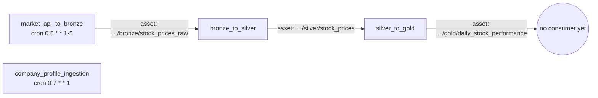

| DAG | Schedule | Purpose |
| --- | --- | --- |
| `market_api_to_bronze` | `0 6 * * 1-5` (06:00 UTC, Mon–Fri) | API → Bronze |
| `bronze_to_silver` | Asset `BRONZE_STOCK_PRICES_ASSET` | Bronze → Silver |
| `silver_to_gold` | Asset `SILVER_STOCK_PRICES_ASSET` | Silver → Gold |
| `company_profile_ingestion` | `0 7 * * 1` (07:00 UTC, Mondays) | Profiles → Bronze → Silver |

Shared settings (`src/orchestration/common.py`), the same for every DAG:

- `catchup=False`, `max_active_runs=1`, `start_date=2024-01-01`
- `default_args`: `retries=3`, `retry_delay=2 min`, `retry_exponential_backoff=True`, `max_retry_delay=15 min`, `on_failure_callback=record_task_failure`
- Asset URIs follow the Snowflake provider format `snowflake://<account>/<database>/<schema>/<table>`; the account is read from `SNOWFLAKE_ACCOUNT`.

**Run identity.** Each DAG's `prepare_run` task returns `{"run_id": <Airflow dag_run id>, "batch_id": <uuid4 hex>}`. Every audit row written by that run carries these two values. Mapped tasks are logged as `ingest_symbol[0]`, `ingest_symbol[1]`, … so each symbol has its own audit row.

### 5.1 `market_api_to_bronze`

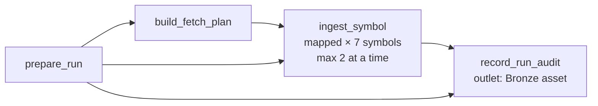

| Task | What it does |
| --- | --- |
| `prepare_run` | Creates `run_id` / `batch_id`. |
| `build_fetch_plan` | For each symbol, reads its Bronze watermark and returns `{symbol, start_date, end_date, load_type}` (`INITIAL` or `INCREMENTAL`). |
| `ingest_symbol` | Dynamically mapped, one task instance per symbol (`max_active_tis_per_dag=2`). Opens an audit row, calls the API, quarantines invalid records, inserts the rest into Bronze, advances that symbol's watermark, closes the audit row with received/loaded/rejected counts. |
| `record_run_audit` | Sums the per-symbol results into one audit row and **emits the Bronze asset event**, which triggers `bronze_to_silver`. |

### 5.2 `bronze_to_silver`

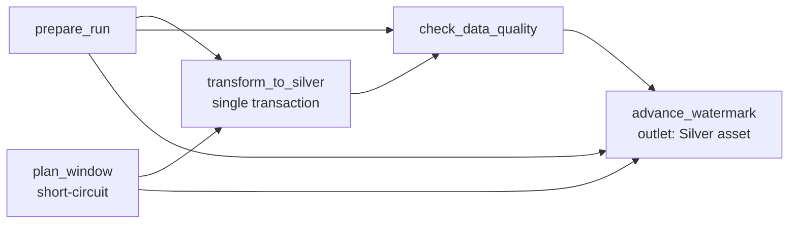

| Task | What it does |
| --- | --- |
| `prepare_run` | Creates `run_id` / `batch_id`. |
| `plan_window` | `@task.short_circuit`. Reads the Silver watermark, runs `10_pending_bronze_stock_prices.sql` and returns `{from_ts, to_ts, pending_records}`. If there is nothing pending it returns `{}` and every downstream task is skipped. |
| `transform_to_silver` | Inside `BEGIN … COMMIT`: window stats → clear earlier DQ rows for this run → quarantine invalid → quarantine duplicates → `MERGE` → write DQ results. |
| `check_data_quality` | Reads `AUDIT.DATA_QUALITY_RESULTS` for this run and logs a summary; logs a warning if any check is `FAIL`. Does **not** fail the task. |
| `advance_watermark` | Sets the Silver watermark to `to_ts` and **emits the Silver asset event**, which triggers `silver_to_gold`. |

### 5.3 `silver_to_gold`

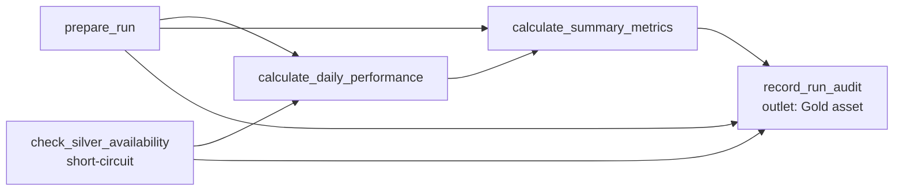

| Task | What it does |
| --- | --- |
| `prepare_run` | Creates `run_id` / `batch_id`. |
| `check_silver_availability` | `@task.short_circuit`. Gold watermark + `20_pending_silver_stock_prices.sql`; skips the run when Silver has nothing new. |
| `calculate_daily_performance` | Runs `21_merge_daily_stock_performance.sql`. |
| `calculate_summary_metrics` | Runs `22_merge_stock_performance_summary.sql`. |
| `record_run_audit` | Counts the rows written by this run (`23_gold_record_counts.sql`), writes the audit row, **then** advances the Gold watermark, and emits the Gold asset event. |

### 5.4 `company_profile_ingestion` (secondary)

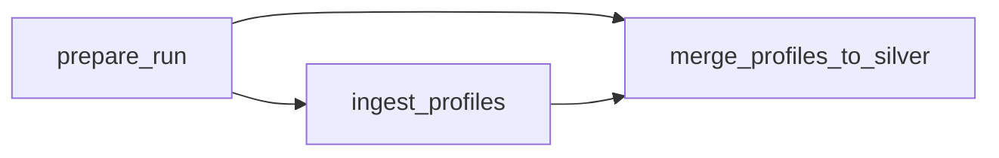

| Task | What it does |
| --- | --- |
| `ingest_profiles` | Loops over the symbols in a single task, calls `profile`, inserts each into `BRONZE.COMPANY_PROFILE_RAW`. |
| `merge_profiles_to_silver` | Plans a window on `BRONZE.COMPANY_PROFILE_RAW`, runs `15_merge_company_profile.sql`, advances the `SILVER.COMPANY_PROFILE` watermark. |

This DAG is independent of the price DAGs. If the profile endpoint fails, prices still flow; the BI view just shows `NULL` company columns.

---

## 6. Bronze Layer

**Tables:** `BRONZE.STOCK_PRICES_RAW`, `BRONZE.COMPANY_PROFILE_RAW` (`sql/03_create_bronze_tables.sql`)

| Column | Meaning |
| --- | --- |
| `RAW_ID` | Autoincrement surrogate key; used as a tie-breaker in de-duplication. |
| `RAW_DATA` | The API record as `VARIANT`, unchanged. |
| `SYMBOL` | Symbol, upper-cased. |
| `SOURCE_SYSTEM` | `FMP`. |
| `API_ENDPOINT` | Endpoint path (e.g. `historical-price-eod/full`), never the full URL. |
| `BATCH_ID` | The ingestion run's batch id. |
| `RUN_ID` | The Airflow run id. |
| `INGESTED_AT` | `CURRENT_TIMESTAMP()` at insert; this is what Silver's watermark tracks. |

### How rows get in

`src/warehouse/loader.py::insert_raw_records()`:

1. Splits the records into chunks of 500.
2. For each chunk, expands the `{value_rows}` placeholder in `sql/transformations/bronze/insert_stock_prices_raw.sql` into `(%s, %s, %s, %s, %s, %s), …`. Only placeholders are generated; every value is a bound parameter, never formatted into the SQL text.
3. Each record is sent as `json.dumps(record)` and converted by Snowflake:

```sql
INSERT INTO BRONZE.STOCK_PRICES_RAW
    (RAW_DATA, SYMBOL, SOURCE_SYSTEM, API_ENDPOINT, BATCH_ID, RUN_ID, INGESTED_AT)
SELECT PARSE_JSON(column1), column2, column3, column4, column5, column6, CURRENT_TIMESTAMP()
FROM VALUES (%s, %s, %s, %s, %s, %s), ...
```

### Why the raw payload is kept

- **Rebuildability:** Silver and Gold can be rebuilt from Bronze at any time by resetting their watermarks; no API calls needed.
- **Auditability:** if a Silver value looks wrong, you can see exactly what the vendor sent.
- **Schema drift tolerance:** new fields from the API are stored automatically in the `VARIANT`; nothing breaks.
- **Replays:** quarantined rows keep their payload too, so they can be inspected and reprocessed.

Bronze is **append-only**: nothing in the pipeline updates or deletes it. That's why re-fetched overlap days appear more than once in Bronze (see [Incremental Processing](#10-incremental-processing)).

From a real run: the first load inserted 500 rows per symbol (3,500 total); the incremental run inserted 2 per symbol (14 total).

---

## 7. Silver Layer

**Tables/views:** `SILVER.VW_STOCK_PRICES_STAGING` → `SILVER.STOCK_PRICES`; `SILVER.VW_COMPANY_PROFILE_STAGING` → `SILVER.COMPANY_PROFILE`.

### 7.1 JSON parsing and type conversion

`SILVER.VW_STOCK_PRICES_STAGING` (in `sql/07_create_views.sql`) reads every Bronze row and extracts typed columns:

```sql
UPPER(COALESCE(r.RAW_DATA:symbol::VARCHAR, r.SYMBOL))      AS SYMBOL,
TRY_TO_DATE(r.RAW_DATA:date::VARCHAR)                      AS TRADE_DATE,
TRY_TO_DECIMAL(r.RAW_DATA:open::VARCHAR, 18, 6)            AS OPEN_PRICE,
TRY_TO_DECIMAL(r.RAW_DATA:high::VARCHAR, 18, 6)            AS HIGH_PRICE,
TRY_TO_DECIMAL(r.RAW_DATA:low::VARCHAR, 18, 6)             AS LOW_PRICE,
TRY_TO_DECIMAL(r.RAW_DATA:close::VARCHAR, 18, 6)           AS CLOSE_PRICE,
TRY_TO_NUMBER(r.RAW_DATA:volume::VARCHAR, 20, 0)           AS VOLUME,
TRY_TO_DECIMAL(r.RAW_DATA:change::VARCHAR, 18, 6)          AS CHANGE_AMOUNT,
TRY_TO_DECIMAL(r.RAW_DATA:changePercent::VARCHAR, 18, 6)   AS CHANGE_PERCENT,
TRY_TO_DECIMAL(r.RAW_DATA:vwap::VARCHAR, 18, 6)            AS VWAP
```

The `TRY_` functions return `NULL` instead of raising on bad input. A malformed value therefore doesn't break the batch; it becomes `NULL` and is caught by the null/price checks below.

### 7.2 Validation flags

The same view adds one boolean per rule, an `ERRORS` array and `IS_VALID`:

| Flag | Rule |
| --- | --- |
| `HAS_NULL_REQUIRED_FIELD` | `SYMBOL`, `TRADE_DATE` or `CLOSE_PRICE` is `NULL` |
| `HAS_INVALID_DATE` | `TRADE_DATE` is `NULL`, in the future, or before `1990-01-01` |
| `HAS_INVALID_PRICE` | `CLOSE_PRICE` is not `> 0`, **or** any OHLC relationship is violated: `HIGH >= LOW`, `HIGH >= OPEN`, `HIGH >= CLOSE`, `LOW <= OPEN`, `LOW <= CLOSE`. A missing optional price (open/high/low) makes the comparison unknown, which isn't counted as a failure. |
| `HAS_INVALID_VOLUME` | `VOLUME` is `NULL` or negative |
| `IS_VALID` | none of the four flags is set |

Putting the rules in one view means the quarantine statement, the DQ results and the `MERGE` all read the same definition of "valid", so they can't disagree.

### 7.3 The Silver load, step by step

`transform_to_silver` runs these inside one transaction (`src/warehouse/loader.py::transaction`):

| # | SQL file | Effect |
| --- | --- | --- |
| 1 | `17_stock_price_window_stats.sql` | Counts total / valid / invalid rows in the window (for the audit log). |
| 2 | `audit/34_…`, `audit/35_…` | Delete DQ errors/results already written by *this* `RUN_ID` (a retry starts clean). |
| 3 | `11_quarantine_invalid_stock_prices.sql` | Invalid rows → `AUDIT.DATA_QUALITY_ERRORS`, one row per error type (`LATERAL FLATTEN` over `ERRORS`). |
| 4 | `12_quarantine_duplicate_stock_prices.sql` | Valid rows that lost the de-duplication → `DATA_QUALITY_ERRORS` as `DUPLICATE_RECORD`. |
| 5 | `13_merge_stock_prices.sql` | Valid, de-duplicated rows → `MERGE INTO SILVER.STOCK_PRICES`. |
| 6 | `14_record_stock_price_dq_results.sql` | One row per check → `AUDIT.DATA_QUALITY_RESULTS`. |

Every statement filters on the same window:

```sql
WHERE INGESTED_AT >  TO_TIMESTAMP_NTZ(%(from_ts)s)
  AND INGESTED_AT <= TO_TIMESTAMP_NTZ(%(to_ts)s)
```

### 7.4 Duplicate handling and de-duplication

There are two kinds of duplicate, handled differently:

**Within one window** (the same symbol and date ingested twice before Silver ran): rows are ranked, and the newest wins.

```sql
ROW_NUMBER() OVER (PARTITION BY SYMBOL, TRADE_DATE
                   ORDER BY INGESTED_AT DESC, RAW_ID DESC)
```

Rank 1 goes to the `MERGE`. Ranks > 1 are quarantined as `DUPLICATE_RECORD` with the message *"superseded by a more recently ingested record for the same symbol and trade date"*.

**Across windows** (a date already in Silver arrives again, e.g. from the 3-day overlap): the `MERGE` updates the existing row. It isn't quarantined, because it's a legitimate refresh.

```sql
MERGE INTO SILVER.STOCK_PRICES t
USING ( ...valid rows, QUALIFY ROW_NUMBER() ... = 1 ) s
   ON t.SYMBOL = s.SYMBOL AND t.TRADE_DATE = s.TRADE_DATE
WHEN MATCHED AND s.INGESTED_AT >= COALESCE(t.INGESTED_AT, TO_TIMESTAMP_NTZ('1900-01-01'))
     THEN UPDATE SET ..., t.LOADED_AT = CURRENT_TIMESTAMP()
WHEN NOT MATCHED THEN INSERT (...)
```

The `s.INGESTED_AT >= t.INGESTED_AT` guard means replaying *older* raw data can never overwrite a newer Silver row.

From a real run: Bronze has 3,514 rows but Silver has 3,500. The 14 extra Bronze rows are the overlap days from the second run; they updated existing Silver rows.

### 7.5 Invalid-record handling

Invalid rows are **not loaded and not deleted**. They are copied to `AUDIT.DATA_QUALITY_ERRORS` with `RUN_ID`, the Bronze `BATCH_ID`, `SYMBOL`, `TRADE_DATE`, `ERROR_TYPE`, `ERROR_MESSAGE` and the full `RAW_RECORD`. The original stays in Bronze. A row that breaks two rules produces two quarantine rows.

### 7.6 Lineage columns in Silver

`SILVER.STOCK_PRICES` keeps the **Bronze** `BATCH_ID`, `RUN_ID` and `INGESTED_AT` of the record that won, plus its own `LOADED_AT`. So any Silver row can be traced back to the exact ingestion batch and raw payload.

### 7.7 Company profiles

`SILVER.VW_COMPANY_PROFILE_STAGING` extracts `COMPANY_NAME`, `INDUSTRY`, `SECTOR`, `EXCHANGE` (`exchangeFullName`, falling back to `exchange`), `CURRENCY`, `COUNTRY` and `MARKET_CAP`. `15_merge_company_profile.sql` keeps the latest profile per symbol (`ROW_NUMBER() … ORDER BY INGESTED_AT DESC`) and `MERGE`s on `SYMBOL`. There are no validation rules for profiles: they are reference data and only enrich the BI view.

---

## 8. Data Quality

### All implemented rules

| Level | Rule | Error type / check name | Where |
| --- | --- | --- | --- |
| Python, before Bronze | Record is a JSON object | `INVALID_API_RECORD` | `data_quality.validate_price_record` |
| Python, before Bronze | `date` and `close` present | `INVALID_API_RECORD` | same |
| Python, before Bronze | `date` is an ISO date | `INVALID_API_RECORD` | same |
| Python, before Bronze | `close` is numeric | `INVALID_API_RECORD` | same |
| SQL, Bronze → Silver | `SYMBOL`, `TRADE_DATE`, `CLOSE_PRICE` not null | `NULL_REQUIRED_FIELD` | staging view |
| SQL, Bronze → Silver | Date parseable, not future, not before 1990 | `INVALID_DATE` / `DATE_VALIDATION` | staging view |
| SQL, Bronze → Silver | `CLOSE > 0`, OHLC relationships hold | `INVALID_PRICE` / `PRICE_RANGE` | staging view |
| SQL, Bronze → Silver | `VOLUME` present and ≥ 0 | `INVALID_VOLUME` / `VOLUME_RANGE` | staging view |
| SQL, Bronze → Silver | One row per `SYMBOL` + `TRADE_DATE` in the window | `DUPLICATE_RECORD` / `DUPLICATES` | `12_…sql`, `14_…sql` |

### What happens to valid and invalid records

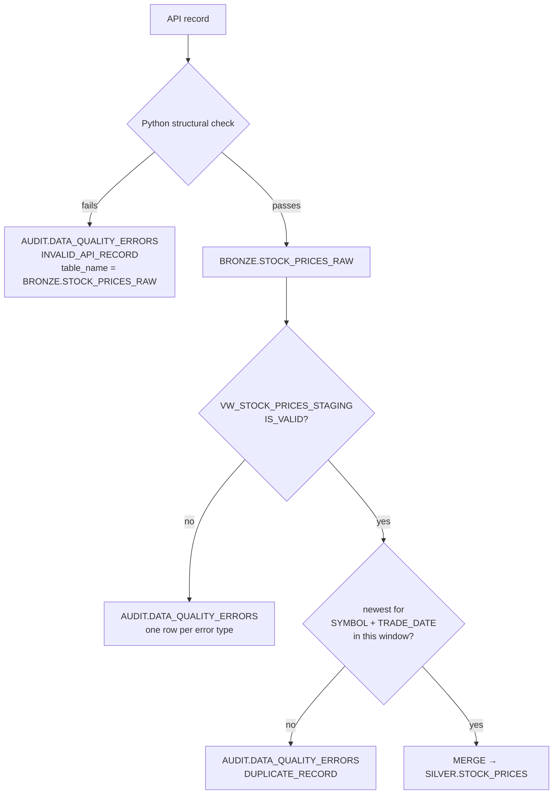

### Check results

`14_record_stock_price_dq_results.sql` writes five rows per Silver run to `AUDIT.DATA_QUALITY_RESULTS`:

| `CHECK_NAME` | `RECORDS_FAILED` counts |
| --- | --- |
| `NULL_REQUIRED_FIELD` | rows with `HAS_NULL_REQUIRED_FIELD` |
| `DATE_VALIDATION` | rows with `HAS_INVALID_DATE` |
| `PRICE_RANGE` | rows with `HAS_INVALID_PRICE` |
| `VOLUME_RANGE` | rows with `HAS_INVALID_VOLUME` |
| `DUPLICATES` | valid rows − distinct `SYMBOL#TRADE_DATE` among them |

`STATUS = 'PASS'` when `RECORDS_FAILED = 0`, else `'FAIL'`. `EXPECTED_RESULT` is `failing records = 0`; `ACTUAL_RESULT` is e.g. `0 of 3500 records failed`.

**A failing check doesn't fail the pipeline.** Bad vendor rows are expected; quarantining them is the designed behaviour. `check_data_quality` logs a warning and the run continues. The failures stay queryable in both audit tables.

From real runs: 10 result rows (5 checks × 2 runs), all `PASS`; 0 quarantined records.

---

## 9. Gold Layer

### 9.1 `GOLD.DAILY_STOCK_PERFORMANCE`

Built by one `MERGE` (`sql/transformations/gold/21_merge_daily_stock_performance.sql`). Key: `(SYMBOL, TRADE_DATE)`.

**Which rows are recalculated:**

```sql
WITH changed AS (            -- symbols touched since the Gold watermark
    SELECT SYMBOL, MIN(TRADE_DATE) AS MIN_TRADE_DATE
    FROM SILVER.STOCK_PRICES
    WHERE LOADED_AT > :from_ts AND LOADED_AT <= :to_ts
    GROUP BY SYMBOL
),
scoped AS (                  -- plus 60 days of earlier history
    SELECT ... FROM SILVER.STOCK_PRICES p JOIN changed c ON c.SYMBOL = p.SYMBOL
    WHERE p.TRADE_DATE >= DATEADD(day, -60, c.MIN_TRADE_DATE)
)
...
WHERE TRADE_DATE >= MIN_TRADE_DATE   -- only changed dates are written back
```

The 60 extra calendar days (`load.gold_lookback_days`) are read so the 30-row windows are already full at the first recalculated date. They feed the window functions but are not written back.

**Metrics:**

| Column | Formula |
| --- | --- |
| `PREV_CLOSE_PRICE` | `LAG(CLOSE_PRICE) OVER (PARTITION BY SYMBOL ORDER BY TRADE_DATE)` |
| `DAILY_RETURN` | `CLOSE_PRICE - PREV_CLOSE_PRICE`, the **absolute** price change |
| `DAILY_RETURN_PERCENT` | `(CLOSE_PRICE - PREV_CLOSE_PRICE) / NULLIF(PREV_CLOSE_PRICE, 0) * 100` |
| `MOVING_AVG_7D` | `AVG(CLOSE_PRICE)` over `ROWS BETWEEN 6 PRECEDING AND CURRENT ROW`, only if that frame has 7 closes, else `NULL` |
| `MOVING_AVG_30D` | same with `29 PRECEDING`, only if 30 closes |
| `VOLATILITY_30D` | `STDDEV_SAMP(DAILY_RETURN_PERCENT)` over the last 30 rows, only if 30 returns exist, else `NULL` |
| `VOLUME`, `VWAP` | carried from Silver |
| `BATCH_ID`, `RUN_ID`, `CALCULATED_AT` | the **Gold** run's identity and timestamp |

Notes:

- Windows are **trading-day rows** (`ROWS BETWEEN`), not calendar days.
- A partial window is published as `NULL`, never as a misleading short average. For each symbol's first rows, the 7-day average starts on row 7, the 30-day on row 30, and volatility on row 31 (the first row has no previous close, so no return).
- Volatility is the sample standard deviation of daily percentage returns. It is **not annualised**.
- `NULLIF(PREV_CLOSE_PRICE, 0)` prevents division by zero.
- Returns, moving averages and volatility come from one statement with chained CTEs (`with_previous → with_returns → with_volatility`), so the table is written once per run instead of three times.

### 9.2 `GOLD.STOCK_PERFORMANCE_SUMMARY`

Built by `22_merge_stock_performance_summary.sql`. Key: `(SYMBOL, PERIOD)`, one row per symbol for `7D`, `30D` and `90D`.

The whole table is recomputed every run from `GOLD.DAILY_STOCK_PERFORMANCE`, as of each symbol's latest trade date:

```sql
WHERE d.TRADE_DATE > DATEADD(day, -p.WINDOW_DAYS, l.LATEST_TRADE_DATE)
```

Periods are **calendar** windows, so they contain fewer trading days. From a real run: `7D` = 5, `30D` = 21, `90D` = 63 trading days.

| Column | Formula |
| --- | --- |
| `START_DATE` / `END_DATE` | `MIN(TRADE_DATE)` / `MAX(TRADE_DATE)` in the period |
| `START_PRICE` / `END_PRICE` | `MIN_BY(CLOSE_PRICE, TRADE_DATE)` / `MAX_BY(CLOSE_PRICE, TRADE_DATE)` |
| `TOTAL_RETURN` | `(END_PRICE - START_PRICE) / NULLIF(START_PRICE, 0) * 100` (percent) |
| `AVG_DAILY_RETURN` | `AVG(DAILY_RETURN_PERCENT)` |
| `AVG_VOLUME` | `AVG(VOLUME)` |
| `MAX_PRICE` / `MIN_PRICE` | `MAX(CLOSE_PRICE)` / `MIN(CLOSE_PRICE)` |
| `VOLATILITY` | `STDDEV_SAMP(DAILY_RETURN_PERCENT)` (not annualised) |
| `TRADING_DAYS` | `COUNT(*)` |

### 9.3 Final consumption view: `GOLD.VW_STOCK_PERFORMANCE`

```sql
SELECT d.SYMBOL, c.COMPANY_NAME, c.SECTOR, c.INDUSTRY, c.EXCHANGE, c.CURRENCY,
       d.TRADE_DATE, d.CLOSE_PRICE, d.PREV_CLOSE_PRICE, d.DAILY_RETURN, d.DAILY_RETURN_PERCENT,
       d.MOVING_AVG_7D, d.MOVING_AVG_30D, d.VOLATILITY_30D, d.VOLUME, d.VWAP,
       s.TOTAL_RETURN AS TOTAL_RETURN_30D, s.AVG_DAILY_RETURN AS AVG_DAILY_RETURN_30D,
       s.AVG_VOLUME AS AVG_VOLUME_30D, s.VOLATILITY AS VOLATILITY_SUMMARY_30D,
       d.BATCH_ID, d.RUN_ID, d.CALCULATED_AT
FROM GOLD.DAILY_STOCK_PERFORMANCE d
LEFT JOIN SILVER.COMPANY_PROFILE c ON c.SYMBOL = d.SYMBOL
LEFT JOIN GOLD.STOCK_PERFORMANCE_SUMMARY s ON s.SYMBOL = d.SYMBOL AND s.PERIOD = '30D';
```

One wide row per symbol per day, ready for a BI tool or ad-hoc SQL. The 30-day summary columns hold the *current* 30-day figures, repeated on every row for that symbol.

From a real run: 3,500 daily rows, 21 summary rows (7 symbols × 3 periods), 3,500 rows in the view.

---

## 10. Incremental Processing

### The control table

`AUDIT.LOAD_WATERMARK` (key `LAYER, TABLE_NAME, SYMBOL`) is the only place the pipeline looks to decide what's already processed. It **never** uses `MAX(date)` from a target table, because that could reflect a half-finished load.

A watermark is written only **after** the step that produced the data has succeeded (`audit.set_watermark`, SQL `32_merge_load_watermark.sql`).

| Layer | `TABLE_NAME` | `SYMBOL` | Field used | Meaning |
| --- | --- | --- | --- | --- |
| Bronze | `BRONZE.STOCK_PRICES_RAW` | each symbol | `LAST_LOADED_DATE` | Latest trade date stored for that symbol |
| Silver | `SILVER.STOCK_PRICES` | `_ALL_` | `LAST_PROCESSED_TS` | Bronze `INGESTED_AT` processed up to |
| Silver | `SILVER.COMPANY_PROFILE` | `_ALL_` | `LAST_PROCESSED_TS` | Bronze profile `INGESTED_AT` processed up to |
| Gold | `GOLD.DAILY_STOCK_PERFORMANCE` | `_ALL_` | `LAST_PROCESSED_TS` | Silver `LOADED_AT` processed up to |

### How each layer picks its window

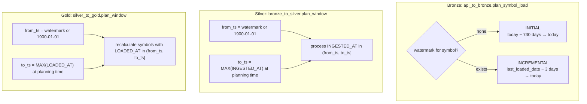

Bronze details (`config/pipeline.yaml → load`):

- `initial_lookback_days: 730`: first load size (overridable with `MARKETFLOW_INITIAL_LOOKBACK_DAYS`).
- `incremental_overlap_days: 3`: re-request a few days to pick up late vendor corrections.
- `max_days_per_request: 1825`: the start date is never earlier than this.
- "Today" is the UTC date.

`to_ts` is captured **once** at planning time and passed to every statement, so all statements in a run see the same rows even if a new Bronze load lands mid-run.

### First run vs subsequent runs

| | First run | Subsequent run |
| --- | --- | --- |
| Bronze | No watermark → `INITIAL`, ~2 years per symbol | `INCREMENTAL`, from `last_loaded_date − 3 days` |
| Silver | `from_ts = 1900-01-01` → all Bronze rows | Only Bronze rows ingested since the last Silver run |
| Gold | All Silver rows | Only changed symbols, from their earliest changed date (with 60 days of context) |

From real runs:

| Run | Bronze inserted | Silver merged | Gold daily rows merged |
| --- | --- | --- | --- |
| 1 (initial) | 3,500 (500 × 7) | 3,500 inserted | 3,500 |
| 2 (incremental) | 14 (2 × 7; the overlap window covered 2 trading days) | 14 updated | 14 |

### Reruns and failures

- **A failed run** never advances its watermark, so the next run picks up the same window again. No manual cleanup is needed.
- **A crash after the data is written but before the watermark moves** (e.g. Silver between `transform_to_silver` and `advance_watermark`) means the same window is processed again; the `MERGE` makes that harmless.
- **Bronze per-symbol:** the watermark is set right after that symbol's insert. If the watermark write itself failed, the rows are in Bronze, the next run re-requests them, and Silver's de-duplication handles the repeat.
- **No new data:** the short-circuit tasks skip the rest of the run, and nothing is written.
- **Full rebuild** of a layer: delete its watermark row(s) and rerun. Bronze is still intact.

```sql
DELETE FROM AUDIT.LOAD_WATERMARK WHERE LAYER = 'SILVER';  -- Silver reprocesses all of Bronze
```

---

## 11. Audit and Observability

### `AUDIT.ETL_RUN_LOG`

One row per executed task. Key: `(RUN_ID, DAG_ID, TASK_ID)`.

| Column | Content |
| --- | --- |
| `RUN_ID`, `DAG_ID`, `TASK_ID` | Airflow run id, DAG, task (mapped tasks as `ingest_symbol[3]`) |
| `BATCH_ID`, `LAYER` | Run batch id; `BRONZE` / `SILVER` / `GOLD` |
| `START_TIME`, `END_TIME`, `DURATION_SECONDS` | Timing |
| `STATUS` | `RUNNING` → `SUCCESS` or `FAILED` |
| `SOURCE_RECORD_COUNT`, `TARGET_RECORD_COUNT`, `REJECTED_RECORD_COUNT` | What came in, what was written, what was rejected |
| `ERROR_MESSAGE` | Exception type and message (max 5,000 chars) |

How it is written:

- `audit.start_step` → `30_start_run_log.sql`: a `MERGE` that inserts a `RUNNING` row, or on a retry resets the existing row to `RUNNING` with cleared counts.
- `audit.finish_step` → `31_finish_run_log.sql`: sets `END_TIME`, `DURATION_SECONDS`, `STATUS` and counts.
- `record_task_failure` (the `on_failure_callback`) → `38_record_failure.sql`: a `MERGE` that marks the row `FAILED`, or **creates** one if the task died before opening it. Errors inside the callback are logged and swallowed, so they can't hide the real failure.

**Why:** you can answer "what ran, how long did it take, how many rows, and why did it fail?" with SQL, without opening Airflow logs.

### `AUDIT.DATA_QUALITY_RESULTS`

One row per check per run (`RUN_ID`, `BATCH_ID`, `TABLE_NAME`, `CHECK_NAME`, `EXPECTED_RESULT`, `ACTUAL_RESULT`, `RECORDS_CHECKED`, `RECORDS_FAILED`, `STATUS`, `CHECKED_AT`).

**Why:** this is the quality history. You can trend failures over time or prove that a given load passed every check.

### `AUDIT.DATA_QUALITY_ERRORS`

One row per rejected record per error (`RUN_ID`, `BATCH_ID`, `TABLE_NAME`, `SYMBOL`, `TRADE_DATE`, `ERROR_TYPE`, `ERROR_MESSAGE`, `RAW_RECORD`, `FAILED_AT`). `TABLE_NAME` says where the rejection happened: `BRONZE.STOCK_PRICES_RAW` (Python check) or `SILVER.STOCK_PRICES` (SQL check).

**Why:** rejected data is never silently dropped. You can inspect the original payload and replay it later.

### `AUDIT.LOAD_WATERMARK`

The incremental state (see [section 10](#10-incremental-processing)), with `LAST_RUN_ID` / `LAST_BATCH_ID` showing which run last advanced it.

### Lineage

```
FMP record
  → BRONZE.STOCK_PRICES_RAW      BATCH_ID / RUN_ID of the ingestion run, INGESTED_AT
  → SILVER.STOCK_PRICES          same Bronze BATCH_ID / RUN_ID / INGESTED_AT, plus LOADED_AT
  → GOLD.DAILY_STOCK_PERFORMANCE BATCH_ID / RUN_ID of the Gold run, CALCULATED_AT
```

Each DAG generates its own `batch_id`. Silver rows keep the Bronze ingestion's ids (so they point at the raw payload); the Silver run's own ids are in `ETL_RUN_LOG` and `DATA_QUALITY_RESULTS`. Gold rows carry the Gold run's ids.

### Logs

Python modules log under the `marketflow.*` logger with `key=value` messages (for example `records received=500 valid=500 rejected=0 duplicate_keys=0`). They appear in the Airflow task logs (UI, or `./logs` on the host).

---

## 12. Idempotency

The goal: running the same DAG twice, or retrying a task, must never create duplicate business records.

| Layer | Mechanism | Effect of re-running |
| --- | --- | --- |
| Bronze | Append-only `INSERT` | New raw rows are added (deliberately: ingestion history is kept). Duplicates are resolved downstream. |
| Silver prices | `MERGE` on `(SYMBOL, TRADE_DATE)` + `ROW_NUMBER` de-dup + `INGESTED_AT` guard | Existing rows updated in place; never two rows per key. |
| Silver profiles | `MERGE` on `SYMBOL` | One row per symbol. |
| Gold daily | `MERGE` on `(SYMBOL, TRADE_DATE)` | Recalculated in place. |
| Gold summary | `MERGE` on `(SYMBOL, PERIOD)` | Recalculated in place. |
| DQ results / errors | `DELETE … WHERE RUN_ID = … AND TABLE_NAME = …` before re-inserting | A retry produces one set of rows, not two. |
| Run log | `MERGE` on `(RUN_ID, DAG_ID, TASK_ID)` | A retry updates the same row. |
| Watermarks | `MERGE` on `(LAYER, TABLE_NAME, SYMBOL)`; written only after success | A failed run doesn't move forward. |

**Primary keys in Snowflake are informational only**: Snowflake doesn't enforce `PRIMARY KEY` constraints. The `PRIMARY KEY` clauses in the DDL document intent; the `MERGE` statements are what actually prevent duplicates. You can confirm it with the duplicate-check query in [section 18](#18-how-to-verify-the-pipeline).

---

## 13. Error Handling

### API failures

| Failure | What happens |
| --- | --- |
| Transient (429, 500, 502, 503, 504, connection reset) | urllib3 retries up to 3 times with exponential backoff (factor 2.0), honouring `Retry-After`. |
| Still failing after HTTP retries | Typed exception raised (`FMPRateLimitError`, `FMPResponseError`) → the Airflow task fails. |
| Bad or missing API key | `FMPAuthenticationError` (from 401/403, from an error body mentioning the key, or at client start if `FMP_API_KEY` is empty). |
| Non-JSON or wrong-shape response | `FMPResponseError`. |
| Empty profile | `get_company_profile` returns `None`; nothing is inserted for that symbol, and the task carries on. |

### Airflow retries

Every task: 3 retries, starting 2 minutes apart, doubling, capped at 15 minutes. On a retry, `start_step` resets the same audit row to `RUNNING`. Only when the last retry fails does `on_failure_callback` mark it `FAILED`.

### One symbol failing in `market_api_to_bronze`

Symbols run as separate mapped task instances, so one bad symbol does not stop the others from being fetched and stored, and their watermarks advance. However, `record_run_audit` uses Airflow's default `all_success` trigger rule, so it won't run, and **that run won't emit the Bronze asset**. Silver isn't triggered until the next successful ingestion run. The rows that did land are then picked up because Silver's window is based on `INGESTED_AT`, not on the run.

### Transformation failures

- **Silver:** quarantine, `MERGE` and DQ results run inside `BEGIN … COMMIT`; any exception triggers `ROLLBACK`, so Silver is never updated without its audit trail. The watermark is a separate, later task.
- **Gold:** the two `MERGE`s are separate statements (no explicit transaction), but both are idempotent and the watermark is only advanced in `record_run_audit` after both have succeeded. A retry recalculates the same window.

### Data-quality failures

These are **not** errors. Invalid records are quarantined, checks are recorded as `FAIL`, a warning is logged, and the pipeline continues with the valid records.

### Secrets in errors

`redact()` replaces `apikey=<value>` with `apikey=***` in any message built from a URL or response body, so an exception or log line never contains the key.

---

## 14. Snowflake Data Model

```
FINANCIAL_MARKET_DB
├── BRONZE
│   ├── STOCK_PRICES_RAW            raw EOD payloads (append-only)
│   └── COMPANY_PROFILE_RAW         raw profile payloads (append-only)
├── SILVER
│   ├── VW_STOCK_PRICES_STAGING     view: parse + type + validation flags
│   ├── VW_COMPANY_PROFILE_STAGING  view: parse + type
│   ├── STOCK_PRICES                PK (SYMBOL, TRADE_DATE)
│   └── COMPANY_PROFILE             PK (SYMBOL)
├── GOLD
│   ├── DAILY_STOCK_PERFORMANCE     PK (SYMBOL, TRADE_DATE)
│   ├── STOCK_PERFORMANCE_SUMMARY   PK (SYMBOL, PERIOD)
│   └── VW_STOCK_PERFORMANCE        view: BI consumption
└── AUDIT
    ├── ETL_RUN_LOG                 PK (RUN_ID, DAG_ID, TASK_ID)
    ├── DATA_QUALITY_RESULTS        RESULT_ID autoincrement
    ├── DATA_QUALITY_ERRORS         ERROR_ID autoincrement
    └── LOAD_WATERMARK              PK (LAYER, TABLE_NAME, SYMBOL)
```

Created by `sql/01_create_database.sql` … `sql/07_create_views.sql`. All scripts are re-runnable (`IF NOT EXISTS` / `OR REPLACE`).

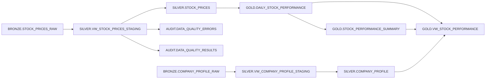

### Columns

**`SILVER.STOCK_PRICES`**: `SYMBOL`, `TRADE_DATE`, `OPEN_PRICE`, `HIGH_PRICE`, `LOW_PRICE`, `CLOSE_PRICE`, `VOLUME`, `CHANGE_AMOUNT`, `CHANGE_PERCENT`, `VWAP` (prices `NUMBER(18,6)`, volume `NUMBER(20,0)`), `SOURCE_SYSTEM`, `BATCH_ID`, `RUN_ID`, `INGESTED_AT`, `LOADED_AT`.

**`SILVER.COMPANY_PROFILE`**: `SYMBOL`, `COMPANY_NAME`, `INDUSTRY`, `SECTOR`, `EXCHANGE`, `CURRENCY`, `COUNTRY`, `MARKET_CAP`, `SOURCE_SYSTEM`, `BATCH_ID`, `RUN_ID`, `INGESTED_AT`, `LOADED_AT`.

**`GOLD.DAILY_STOCK_PERFORMANCE`**: `SYMBOL`, `TRADE_DATE`, `CLOSE_PRICE`, `PREV_CLOSE_PRICE`, `DAILY_RETURN`, `DAILY_RETURN_PERCENT`, `MOVING_AVG_7D`, `MOVING_AVG_30D`, `VOLATILITY_30D`, `VOLUME`, `VWAP`, `BATCH_ID`, `RUN_ID`, `CALCULATED_AT`.

**`GOLD.STOCK_PERFORMANCE_SUMMARY`**: `SYMBOL`, `PERIOD`, `START_DATE`, `END_DATE`, `START_PRICE`, `END_PRICE`, `TOTAL_RETURN`, `AVG_DAILY_RETURN`, `AVG_VOLUME`, `MAX_PRICE`, `MIN_PRICE`, `VOLATILITY`, `TRADING_DAYS`, `BATCH_ID`, `RUN_ID`, `CALCULATED_AT`.

**`AUDIT.LOAD_WATERMARK`**: `LAYER`, `TABLE_NAME`, `SYMBOL`, `LAST_LOADED_DATE`, `LAST_PROCESSED_TS`, `LAST_RUN_ID`, `LAST_BATCH_ID`, `UPDATED_AT`.

Bronze and the other audit tables are listed in sections [6](#6-bronze-layer) and [11](#11-audit-and-observability).

Naming note: the Gold columns are `MOVING_AVG_7D`, not `7D_MOVING_AVG`, because unquoted Snowflake identifiers can't start with a digit.

---

## 15. Docker Architecture

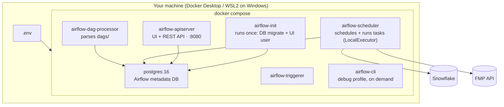

| Service | Role |
| --- | --- |
| `postgres` | Airflow's own metadata database (DAG runs, task states, XComs). No pipeline data is stored here. |
| `airflow-init` | Runs once: migrates the metadata DB and creates the UI user from `.env`. |
| `airflow-apiserver` | Airflow 3 UI and API on `http://localhost:8080`. |
| `airflow-scheduler` | Schedules runs. With LocalExecutor, the tasks themselves run as worker processes inside this container. |
| `airflow-dag-processor` | Parses the DAG files. |
| `airflow-triggerer` | Standard Airflow 3 component for deferrable tasks. None of this project's tasks are deferrable. |
| `airflow-cli` | Optional helper (`--profile debug`) for one-off commands. |

**Image:** `docker/Dockerfile` extends `apache/airflow:3.4.0` (Python 3.13) and installs `requirements.txt` (Snowflake provider, Snowflake connector, `requests`, `PyYAML`, `pytest`) using the official Airflow constraints file for that exact version.

**Mounts:** `./dags → /opt/airflow/dags`; `./src`, `./sql`, `./config`, `./scripts`, `./tests`, `./pytest.ini` and `./dags` → `/opt/airflow/project/...`; `./logs → /opt/airflow/logs`. Code edits on the host are picked up without rebuilding the image. `PYTHONPATH=/opt/airflow/project` makes `import src...` work.

**Why no local Python virtual environment is needed:** every runtime dependency is baked into the image, and the code is mounted in. The pipeline, the Snowflake setup script and the full test suite all run inside the containers. A local venv (`requirements-dev.txt`) is only an optional convenience for running unit tests outside Docker.

**Health checks:** Postgres uses `pg_isready`; the API server uses `/api/v2/monitor/health`; the scheduler, DAG processor and triggerer use `airflow jobs check` with a 30-second timeout (the Airflow CLI can take more than 10 s to start under WSL2).

---

## 16. Configuration and Secrets

### Two kinds of configuration

| Kind | Where | Examples |
| --- | --- | --- |
| Business / runtime settings | `config/pipeline.yaml`, `config/symbols.yaml` (committed) | Endpoints, retries, lookback days, schema names, symbol list |
| Secrets and environment | `.env` (git-ignored) | API key, Snowflake credentials |

`src/utils/config.py::get_config()` loads the YAML once per process into frozen dataclasses (`PipelineConfig`, `ApiConfig`, `LoadConfig`, `SnowflakeConfig`).

### `.env` and `.env.example`

- **`.env.example`** is committed. It lists every variable with empty or safe default values and comments.
- **`.env`** is your copy with real values. It is listed in `.gitignore` and `.dockerignore`, so it is never committed and never copied into the image.

```bash
cp .env.example .env     # Windows: copy .env.example .env
```

| Variable | Used by |
| --- | --- |
| `FMP_API_KEY` | `FMPClient` |
| `SNOWFLAKE_ACCOUNT`, `SNOWFLAKE_USER`, `SNOWFLAKE_PASSWORD` | Snowflake connection; `SNOWFLAKE_ACCOUNT` also goes into asset URIs |
| `SNOWFLAKE_ROLE`, `SNOWFLAKE_WAREHOUSE`, `SNOWFLAKE_DATABASE`, `SNOWFLAKE_SCHEMA` | Snowflake connection |
| `AIRFLOW_UID`, `AIRFLOW_IMAGE_NAME` | docker-compose |
| `_AIRFLOW_WWW_USER_USERNAME`, `_AIRFLOW_WWW_USER_PASSWORD` | UI login created by `airflow-init` |
| `FERNET_KEY`, `AIRFLOW__API_AUTH__JWT_SECRET` | Airflow internals: set your own outside local development |

Optional overrides: `MARKETFLOW_SYMBOLS` (comma-separated list instead of `symbols.yaml`), `MARKETFLOW_INITIAL_LOOKBACK_DAYS`, `FMP_BASE_URL`, `SNOWFLAKE_CONN_ID`.

### How credentials reach the code

1. `docker-compose.yml` loads `.env` into every Airflow container (`env_file`).
2. It also builds the Airflow connection `snowflake_default` from those variables via `AIRFLOW_CONN_SNOWFLAKE_DEFAULT` (JSON). Nothing is configured by hand in the UI.
3. `src/warehouse/connection.py` opens connections through `SnowflakeHook("snowflake_default")`; outside Airflow it falls back to the `SNOWFLAKE_*` environment variables directly.
4. `FMPClient` reads `FMP_API_KEY` from the environment.

Credentials are never written to logs, SQL files or Snowflake tables. The repository contains no real secrets.

---

## 17. How to Run the Project

Prerequisites: Docker Desktop (on Windows, with WSL2 installed), an FMP API key, and a Snowflake account with a role that can create a database and a running warehouse.

```bash
# 1. Configure
cd marketflow-data-engineering
cp .env.example .env                 # then fill in FMP_API_KEY and SNOWFLAKE_* values

# 2. Create the Snowflake objects
#    Run sql/01_create_database.sql … sql/07_create_views.sql in order in a Snowsight worksheet,
#    or, after step 3:
#    docker compose run --rm airflow-cli python /opt/airflow/project/scripts/setup_snowflake.py

# 3. Build and start Airflow (first build downloads the Airflow image; it can take 15–20 minutes)
docker compose build
docker compose up -d
docker compose ps                    # wait until every service shows (healthy)

# 4. Unpause the DAGs (all DAGs start paused). Unpause the downstream DAGs first.
docker compose exec airflow-scheduler airflow dags unpause bronze_to_silver
docker compose exec airflow-scheduler airflow dags unpause silver_to_gold
docker compose exec airflow-scheduler airflow dags unpause company_profile_ingestion
docker compose exec airflow-scheduler airflow dags unpause market_api_to_bronze

# 5. Trigger the ingestion DAGs (profiles first, so the BI view has company names)
docker compose exec airflow-scheduler airflow dags trigger company_profile_ingestion
docker compose exec airflow-scheduler airflow dags trigger market_api_to_bronze
#    bronze_to_silver and silver_to_gold then start by themselves through asset events.

# 6. Watch progress
docker compose exec airflow-scheduler airflow dags list-runs market_api_to_bronze
docker compose exec airflow-scheduler airflow dags list-runs silver_to_gold
docker compose logs -f airflow-scheduler
```

The UI at <http://localhost:8080> (default login `airflow` / `airflow`) can be used instead of the CLI for steps 4–6.

**Note:** with `catchup=False`, unpausing a cron DAG makes Airflow run its most recent missed schedule straight away. So unpausing `market_api_to_bronze` already starts a run, and a manual trigger adds a second one. The second run simply loads the incremental overlap; that's harmless.

Run the tests inside the container:

```bash
docker compose exec -w /opt/airflow/project airflow-scheduler python -m pytest -q
```

Stop:

```bash
docker compose down        # stop containers, keep Airflow metadata
docker compose down -v     # also delete the Airflow metadata DB (Snowflake data is untouched)
```

---

## 18. How to Verify the Pipeline

Run in a Snowsight worksheet with a role that has access to `FINANCIAL_MARKET_DB`.

```sql
USE DATABASE FINANCIAL_MARKET_DB;
```

**Row counts per layer**

```sql
SELECT 'BRONZE.STOCK_PRICES_RAW' AS tbl, COUNT(*) AS row_count FROM BRONZE.STOCK_PRICES_RAW
UNION ALL SELECT 'BRONZE.COMPANY_PROFILE_RAW',     COUNT(*) FROM BRONZE.COMPANY_PROFILE_RAW
UNION ALL SELECT 'SILVER.STOCK_PRICES',            COUNT(*) FROM SILVER.STOCK_PRICES
UNION ALL SELECT 'SILVER.COMPANY_PROFILE',         COUNT(*) FROM SILVER.COMPANY_PROFILE
UNION ALL SELECT 'GOLD.DAILY_STOCK_PERFORMANCE',   COUNT(*) FROM GOLD.DAILY_STOCK_PERFORMANCE
UNION ALL SELECT 'GOLD.STOCK_PERFORMANCE_SUMMARY', COUNT(*) FROM GOLD.STOCK_PERFORMANCE_SUMMARY;
```

**Bronze records**

```sql
-- Loads per run and symbol
SELECT RUN_ID, SYMBOL, COUNT(*) AS records, MIN(INGESTED_AT) AS ingested_at
FROM BRONZE.STOCK_PRICES_RAW
GROUP BY RUN_ID, SYMBOL
ORDER BY ingested_at DESC, SYMBOL;

-- Look inside a raw payload
SELECT SYMBOL, RAW_DATA:date::DATE AS trade_date, RAW_DATA:close::FLOAT AS close, RAW_DATA
FROM BRONZE.STOCK_PRICES_RAW
ORDER BY INGESTED_AT DESC LIMIT 10;
```

**Silver records**

```sql
SELECT SYMBOL, COUNT(*) AS trading_days, MIN(TRADE_DATE) AS first_day, MAX(TRADE_DATE) AS last_day
FROM SILVER.STOCK_PRICES
GROUP BY SYMBOL ORDER BY SYMBOL;

-- Business key really is unique (expect zero rows)
SELECT SYMBOL, TRADE_DATE, COUNT(*)
FROM SILVER.STOCK_PRICES
GROUP BY SYMBOL, TRADE_DATE HAVING COUNT(*) > 1;

-- Re-fetched overlap days: Bronze rows per key > 1, Silver still one row
SELECT SYMBOL, RAW_DATA:date::DATE AS trade_date, COUNT(*) AS bronze_copies
FROM BRONZE.STOCK_PRICES_RAW
GROUP BY 1, 2 HAVING COUNT(*) > 1
ORDER BY trade_date DESC, SYMBOL;
```

**Gold records**

```sql
-- Latest day per symbol
SELECT SYMBOL, TRADE_DATE, CLOSE_PRICE, DAILY_RETURN_PERCENT,
       MOVING_AVG_7D, MOVING_AVG_30D, VOLATILITY_30D
FROM GOLD.DAILY_STOCK_PERFORMANCE
QUALIFY ROW_NUMBER() OVER (PARTITION BY SYMBOL ORDER BY TRADE_DATE DESC) = 1
ORDER BY SYMBOL;

SELECT SYMBOL, PERIOD, START_DATE, END_DATE, TOTAL_RETURN, AVG_DAILY_RETURN, VOLATILITY, TRADING_DAYS
FROM GOLD.STOCK_PERFORMANCE_SUMMARY ORDER BY SYMBOL, PERIOD;

SELECT * FROM GOLD.VW_STOCK_PERFORMANCE ORDER BY TRADE_DATE DESC, SYMBOL LIMIT 20;
```

**Rejected records**

```sql
SELECT TABLE_NAME, ERROR_TYPE, COUNT(*) AS records
FROM AUDIT.DATA_QUALITY_ERRORS
GROUP BY 1, 2 ORDER BY 1, 2;

SELECT FAILED_AT, TABLE_NAME, SYMBOL, TRADE_DATE, ERROR_TYPE, ERROR_MESSAGE, RAW_RECORD
FROM AUDIT.DATA_QUALITY_ERRORS
ORDER BY FAILED_AT DESC LIMIT 50;
```

**Audit runs**

```sql
SELECT START_TIME, DAG_ID, TASK_ID, STATUS, DURATION_SECONDS,
       SOURCE_RECORD_COUNT, TARGET_RECORD_COUNT, REJECTED_RECORD_COUNT, ERROR_MESSAGE
FROM AUDIT.ETL_RUN_LOG
ORDER BY START_TIME DESC LIMIT 50;

-- Anything that failed
SELECT * FROM AUDIT.ETL_RUN_LOG WHERE STATUS = 'FAILED' ORDER BY START_TIME DESC;

SELECT LAYER, TABLE_NAME, SYMBOL, LAST_LOADED_DATE, LAST_PROCESSED_TS, LAST_RUN_ID, UPDATED_AT
FROM AUDIT.LOAD_WATERMARK ORDER BY LAYER, TABLE_NAME, SYMBOL;
```

**Data quality results**

```sql
SELECT CHECKED_AT, RUN_ID, CHECK_NAME, STATUS, RECORDS_CHECKED, RECORDS_FAILED, ACTUAL_RESULT
FROM AUDIT.DATA_QUALITY_RESULTS
ORDER BY CHECKED_AT DESC, CHECK_NAME;
```

**Lineage: from a Gold row back to its raw payload**

```sql
SELECT g.SYMBOL, g.TRADE_DATE, g.CLOSE_PRICE, s.BATCH_ID AS bronze_batch, b.RAW_DATA
FROM GOLD.DAILY_STOCK_PERFORMANCE g
JOIN SILVER.STOCK_PRICES s
  ON s.SYMBOL = g.SYMBOL AND s.TRADE_DATE = g.TRADE_DATE
JOIN BRONZE.STOCK_PRICES_RAW b
  ON b.BATCH_ID = s.BATCH_ID AND b.SYMBOL = s.SYMBOL AND b.RAW_DATA:date::DATE = s.TRADE_DATE
WHERE g.SYMBOL = 'AAPL'
ORDER BY g.TRADE_DATE DESC LIMIT 5;
```

---

## 19. How I Would Explain This Project in an Interview

> MarketFlow is a daily batch pipeline for stock market data. I pull end-of-day prices for seven stocks from the Financial Modeling Prep API, land them in Snowflake, and build analytics on top, all orchestrated with Airflow running in Docker.
>
> I used a medallion setup. Bronze stores the API response exactly as it came back, as a VARIANT column, and it's append-only. That way I can always rebuild everything downstream without calling the API again. Silver parses that JSON into proper types and runs validation: nulls, dates, price sanity checks like high has to be above low, and negative volume. Anything that fails doesn't get dropped; it goes into a quarantine table with the original payload, and every check writes a pass/fail row. Gold has the analytics: daily returns, 7- and 30-day moving averages, 30-day volatility, and 7/30/90-day summaries, all done with Snowflake window functions.
>
> For incremental loading I keep a watermark table, and it's only updated after a step succeeds. So if something fails halfway, the next run just picks up the same window again. All the Silver and Gold writes are MERGEs on the business key, so reruns don't create duplicates. I also re-fetch the last three days on every run to catch late corrections from the vendor, and the MERGE makes that safe.
>
> On the Airflow side, Silver and Gold are triggered by data assets instead of fixed times, so they only run when upstream data actually changed. Every task writes to an audit log with row counts, timings and errors, so I can debug a run from SQL without digging through logs.

---

## 20. Troubleshooting

| Symptom | Cause | Fix |
| --- | --- | --- |
| Docker Desktop is running but `docker compose` returns HTTP 500 errors; `wsl -l -v` prints usage text | WSL2 isn't installed (Windows). | Run `wsl --install` in an elevated PowerShell, reboot, start Docker Desktop. |
| `docker` isn't recognised in a terminal | Docker Desktop was installed to a non-default folder that isn't on `PATH`. | Add Docker Desktop's `resources\bin` folder to `PATH`, or use the full path to `docker.exe`. |
| First `docker compose build` takes a long time | Downloads the Airflow base image and installs providers. | Expected on first build (can be 15–20 minutes); later builds use the cache. |
| `env file .env not found` | `.env` was not created. | `cp .env.example .env` and fill it in. |
| Every DAG shows an import error: `URI format snowflake:// must contain database, schema, and table names` | Snowflake asset URIs must be `snowflake://<account>/<db>/<schema>/<table>`. | Already handled in `src/orchestration/common.py`, which reads the account from `SNOWFLAKE_ACCOUNT`. Make sure it's set in `.env`. |
| Scheduler / DAG processor / triggerer show `(unhealthy)` but work | `airflow jobs check` exceeded the health-check timeout (slow CLI start under WSL2). | The timeout is 30 s in `docker-compose.yml`; increase it further if your machine is slower. |
| `FMP_API_KEY is not set` | Empty in `.env`, or containers started before it was set. | Fill it in, then `docker compose up -d --force-recreate`. |
| `authentication failed ... check FMP_API_KEY` | Wrong key, or the endpoint isn't on your FMP plan. | Check the key; the price DAG only needs the EOD endpoint. |
| `250001 Could not connect to Snowflake backend` | `SNOWFLAKE_ACCOUNT` is a full URL. | Use the account identifier only (e.g. `abcd-xy12345`). |
| `Object ... does not exist or not authorized` | Setup scripts not run, or `SNOWFLAKE_ROLE` has no privileges on the objects (e.g. they were created by a different role). | Run `sql/01..07`; grant `USAGE` on the database/schemas and DML on the tables to the pipeline role, or set `SNOWFLAKE_ROLE` to the role that owns them. |
| `bronze_to_silver` / `silver_to_gold` never start | Paused (all DAGs start paused), or the upstream run did not finish successfully. | Unpause them; check the upstream run. In `market_api_to_bronze`, `record_run_audit` must succeed for the asset event to fire. |
| A run finishes in seconds with most tasks skipped | The short-circuit task found no new data. | Expected when nothing changed. |
| Two runs appear right after unpausing | Unpausing runs the latest missed schedule, plus your manual trigger. | Harmless; the second run loads only the overlap window. |
| Bronze has more rows than Silver | Re-fetched overlap days are appended to Bronze; Silver `MERGE`s them into existing rows. | Expected. |
| `MOVING_AVG_*` / `VOLATILITY_30D` are `NULL` for a symbol's first rows | A partial window is published as `NULL` by design. | Expected. |
| Company columns are `NULL` in `VW_STOCK_PERFORMANCE` | `company_profile_ingestion` hasn't run, or the profile endpoint failed. | Trigger `company_profile_ingestion`. |
| Records in `AUDIT.DATA_QUALITY_ERRORS` | Vendor data failed validation and was quarantined. | Inspect `ERROR_TYPE` and `RAW_RECORD`; the run itself still succeeded. |
| Port 8080 already in use | Another process uses it. | Change `"8080:8080"` to e.g. `"8081:8080"` in `docker-compose.yml`. |
| Need to rebuild Silver/Gold from Bronze | — | `DELETE FROM AUDIT.LOAD_WATERMARK WHERE LAYER IN ('SILVER','GOLD');` then trigger `bronze_to_silver`. |
