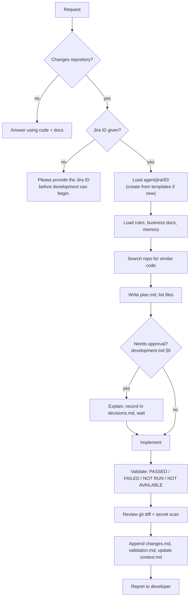

# Agent framework design

The development agent is **repository-native**: its instructions, knowledge,
memory and audit trail are Markdown files versioned with the code. Any agent
session (or human) that opens the repository gets the same context.

## Components

```
CLAUDE.md                         operating contract, read first every session
agent/
├── rules/                        permanent guardrails derived from the code
│   ├── development.md            workflow, Jira gate, read-before-write, change control, git
│   ├── airflow.md                DAG conventions
│   ├── snowflake.md              data model and SQL conventions
│   ├── python.md                 module style and reusable helpers
│   ├── security.md               secrets handling (highest priority)
│   └── validation.md             available checks and status vocabulary
├── memory/
│   ├── global.md                 confirmed project-wide decisions
│   └── users/<dev>.md            confirmed developer preferences
├── jira/<JIRA-ID>/               per-ticket context, plan, decisions, changes, validation
└── templates/                    skeletons for the above
docs/
├── architecture/  business/  airflow/  snowflake/  development/
├── DATA_FLOW.md                  (existing)
README.md                         (existing)
```

## Request lifecycle



## Precedence

Security → current explicit requirement → Jira acceptance criteria → existing
architecture → existing conventions → `agent/rules` → `docs/business` →
developer memory → generic best practice. (`CLAUDE.md` §7)

## Why Markdown in the repository

- Reviewable in pull requests like code; history in git.
- No extra infrastructure; works offline and with any agent that reads files.
- Clean upgrade path: future tools (see `future_integrations.md`) read and
  write the same files instead of replacing them.

## Maintaining the framework

Changes to `CLAUDE.md`, `agent/rules/` or `agent/templates/` are development
work: they need a Jira ID and are recorded like any other change. Rules must
describe what the code actually does; when the code's conventions change
deliberately, update the matching rule in the same ticket.
